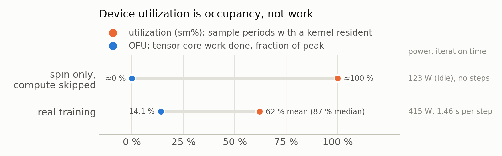

## Summary
This chapter covers how to measure and evaluate training efficiency, in the order the methods are used: how to measure and decompose a step (find out where the time goes first), how to compute cost and utilization, and continuous monitoring and supporting methods; it ends with a problem-localization table (find the bottleneck from a symptom). The item numbers below refer to the sections that follow.

**How to measure and decompose**: find out where the time goes first (items 1–3)
- Per-rank telemetry and `severe stall`: record each rank's wait and compute to find the rank that slows everyone down (see item 1)
- `wall clock`: compute the complete s/step from log timestamps (see item 2)
- CUDA event decomposition: split a training step into `arrival` / `forward` / `backward` / `host residual` (see item 3)

**How to compute cost and utilization**: cost from the true `wall clock`, utilization from actual compute (items 4–5)
- `GPU-hour`: compute it from the mean `wall clock`, never the median (see item 4)
- `MFU / HFU / OFU`: look at actual compute utilization, not device utilization (see item 5)

**Continuous monitoring and supporting methods**: continuous recording and regression monitoring during training, plus ways to measure one segment in isolation (items 6–10)
- Regression test: run a fixed recipe periodically after code changes and compare against baseline thresholds (bands); alert when exceeded (see item 6)
- NaN / inf gradient forensics: save the scene when one occurs for reproduction and diagnosis, without slowing normal training (see item 7)
- Dataloader harness: skip the compute to measure the dataloader's time on its own, and break the startup time down by phase (see item 8)
- Training-log enhancement: break down the multimodal training loss and locate abnormal input samples (see item 9)
- Enable torch.profiler: break down the overhead by module and operator (see item 10)

**Problem localization**: when you hit a specific symptom, look at the matching metrics to locate the bottleneck:

| Symptom | What it looks like | Metrics to look at |
|---|---|---|
| Training step slower than the hardware suggests, cause unknown | High device utilization (`sm%`) and normal loss, but the `wall clock` of each training step is longer than the hardware suggests | True `wall clock` / step; `arrival`, `forward`, `backward`, `host residual` (items 2 and 3; down to modules and operators in item 10) |
| One rank slows down all ranks | The mean `wall clock` per training step is far above its median; periodic multi-second training steps, where some ranks are waiting for the batch while others are already waiting for gradient synchronization | `arrival` (i.e. data wait), `severe stall`, `stall gap`, `clean step` (item 1; measure the dataloader alone in item 8) |
| A fixed extra cost in every training step | The mean `wall clock` per training step is close to its median (no long tail), but both are above the reference configuration: every training step reliably costs a fixed extra amount | `forward`, `backward`, `host residual` (item 3; down to operators in item 10) |
| GPU utilization near 100% but throughput low | Device utilization (`sm%`) near 100%, but `OFU` is low and power draw is close to idle | `MFU`, `HFU`, `OFU`, `HFU / OFU`, power; not device utilization (`sm%`) (item 5) |
| Reported numbers disagree with the actual GPU-hour bill | The logged `iteration time` is below the true `wall clock`; or a cost estimated from the median is below the actual `GPU-hour` bill | True `wall clock` / step, `GPU-hour` (from the mean), compared against `iteration time` (items 2 and 4) |

---

## 1. Per-rank telemetry and `severe stall`: record each rank's wait and compute to find the rank that slows everyone down

**Idea**:


In synchronous data-parallel training, the duration of a training step is set by the slowest rank. A job-level step time alone cannot tell the following apart: whether one rank is slow or all ranks are slow; whether data supply is insufficient (a few ranks receive their batch late, or the whole dataloader lags) or compute itself is slow (an abnormal or interfered node, or a global slowdown). Each case is handled differently, so the cause has to be located first.
At every training step each rank produces one record, which rank 0 gathers. Four quantities are derived from these records:
- `instrument wall`: for each training step, the sum of a rank's `arrival` (time waiting for the batch) and `arrival-else` (time from receiving the batch to the end of the step, including H2D copy, forward, backward and gradient synchronization), maximized over ranks. This is the total time of the training step on the slowest rank (rank 3 in the figure).
- `severe stall`: a training step in which the spread of `arrival` across ranks (maximum minus minimum, e.g. rank 3 versus rank 0 in the figure) exceeds 2 s, meaning some rank is waiting for data.
- `clean step`: a training step whose maximum `arrival` is at most 0.1 s, meaning the dataloader caused no visible wait.
- `stall gap`: the mean `instrument wall` over all training steps minus the mean `instrument wall` over `clean step`s, i.e. the extra time caused by stalls.

The stall metric uses a difference rather than an absolute value: if one rank waits 11 s while the others wait only 0.1 s, the dataloader has a problem regardless of how long compute takes. The analysis should follow the rank that determines the step duration, not an average over ranks, and should report the mean, the median, the severe ratio, and the p95 / p99 of `arrival` together; these four correspond to four different failure shapes.

**Implementation**:

Each record contains: the time this rank waited for its batch (`arrival`); the time from receiving the batch to the end of the training step (including H2D copy, forward, backward and gradient synchronization, called `arrival-else`, stored in the field `fwd_bwd_time_s`); GPU-event timings of forward and backward (see item 3); sample and token counts; and device memory. Rank 0 gathers the records from all ranks and appends them to a file as one JSON-lines row per step.

The analysis looks like this:

```python
# One record per rank per step, gathered by rank 0 and written as JSON-lines; fields:
#   arrival_time_s, fwd_bwd_time_s, forward_time_s, backward_time_s,
#   sample_count, real_tokens, device_used_bytes
rows = [json.loads(l) for l in open("rank_timings.jsonl")]
sel  = rows[20:1000]                                   # drop the compile warm-up steps
wall = [max(x["arrival_time_s"] + x["fwd_bwd_time_s"] for x in r["ranks"]) for r in sel]
sev  = sum(1 for r in sel
           if max(x["arrival_time_s"] for x in r["ranks"])
            - min(x["arrival_time_s"] for x in r["ranks"]) > 2)
```

**Experiment data**: (internal data, for reference)

Setup: 2B model, 16 nodes / 128 GPUs, 1,000-step benchmark; the metric is the `instrument wall` from per-rank telemetry (steps 21–1,000), and severe uses the "arrival spread > 2 s" definition. The table shows two stage 2 configurations of the same model on the same data. Per-rank telemetry alone is enough to tell which kind of problem each one has:

| Configuration | `instrument wall` mean (s) | `instrument wall` median (s) | `severe stall` ratio | `arrival` p95 (s) | Verdict |
|---|---:|---:|---:|---:|---|
| Configuration A | 2.138 | 1.104 | 18.0% | 6.78 | Mean far above median and a high `severe stall` ratio: a long-tail latency problem; improve the dataloader's supply stability |
| Configuration B | 1.576 | 1.556 | 0.0% | 0.29 | Mean close to median, no stalls: dataloader supply is stable; investigate compute and other overheads next (item 3, CUDA event decomposition) |

Notes:
- Tables in this chapter use the `severe stall` definition (arrival spread across ranks > 2 s). Other material may use an `absolute stall` definition (slowest rank's wait > 5 s); state which one is used.
- Limitation of the difference-based `severe stall`: when all ranks wait for data at the same time, the arrival spread is small and `severe stall` cannot detect it. For example, one experiment had a mean of 7.32 s/step but only 2.3% of training steps were classified as `severe stall`, because all ranks were waiting simultaneously. Read the mean, the median and the arrival spread together; the `absolute stall` definition (slowest rank waits > 5 s) can be used as a complement to cover this case.
- The mean `instrument wall` does not equal the mean true `wall clock`: `instrument wall` excludes the inter-step tail (the time between the previous step's optimizer end and the next step's start, including the wait for the next batch and host-side work), so it is smaller than the true `wall clock` based on trainer-log timestamps by tens of milliseconds (see item 2). In addition, the first 20 or so training steps include compile and first-epoch effects and should be dropped from the statistics.

**When to use**: all training jobs; recommended on by default. The cost is one JSON row per training step; afterwards, questions like "where does the time go" can be answered by a single query over existing data.

---

## 2. `wall clock`: compute the complete s/step from log timestamps

**Idea**:

`wall clock` is the complete duration of a training step, including data wait, compute and host tail; the trainer log's `iteration time` covers only the compute part and therefore reads low. Cost accounting and before/after comparisons should use `wall clock`; `iteration time` is for diagnosis.


The trainer prints an `iteration time` for every training step. It measures rank 0's compute: the CUDA event interval from gradient zeroing to the end of the optimizer step. It does **not** include the time spent waiting for the batch before the step, nor the host work after the step (logging, control-flow checks, checkpoint saving). It therefore underestimates the true duration of a training step: in the 2B stage 2 experiment (the shortest training step) by about 13%. The `instrument wall` of item 1 likewise excludes host work after the step and has the same underestimate. `wall clock` takes the time difference between two rank-0 log lines divided by the number of training steps between them. The result is everything a training step spends: the data wait in the figure, compute (forward / backward, optimizer) and the host tail.

**Implementation**:

A long training job is usually a chain of scheduler allocations: when an allocation hits its time limit (or is preempted, or a node fails), the scheduler requeues the job, which resumes from the latest checkpoint (autoresume). Each allocation is called a segment (also a job attempt). Between segments there is queueing, restart and checkpoint-loading time that is not training-step time, so `wall clock` must be computed per segment:
1. Read the rank-0 log of every autoresume segment;
2. Match the lines that carry a timestamp and a training step number (for example `[rank0] <timestamp> ... Step: N/total, ... Iteration time`);
3. Within each segment, keep only the lines inside the chosen window and drop the first 20 lines of that segment (compile warm-up and cache fill after every start or restart);
4. For each segment take the timestamp difference (seconds) and step-number difference (steps) between the last and the first line, then divide the sum of seconds over all segments by the sum of steps to get the training-step time.

Follow these rules when implementing it:
- **Never subtract timestamps across segments**: the gap between segments (queueing, restart, checkpoint loading and warm-up) is not training-step time.
- **Count rerun training steps in both segments**: after a job resumes it retrains from the latest checkpoint. For example, if it is requeued at step 9,400 and resumes from the step-9,000 checkpoint, steps 9,001–9,400 run once in each segment. The time spent on the rerun is real training cost and must be counted; counting both runs makes the computed training-step time reflect the actual training rate.
- **State the statistics window**: the whole run, or the last 1,000 steps. Everything that happens inside the window (checkpointing, evaluation pauses, etc.) is counted; a window that is too short makes the result noisy, so use at least a few hundred training steps.
- **Use the same definition for the baseline and the new result**: when quoting the gain of a change over a baseline, recompute the baseline from the true `wall clock`; for historical data whose logs are gone and cannot be recomputed, state the original definition. If the baseline comes from the trainer log's `iteration time`, the resulting speedup is only a lower bound of the true gain.
- **Regression tests versus cost accounting**: a regression test (see item 6) may set its band on the median or on `iteration time` for stability, but cost accounting should still use the mean `wall clock`.

The script below is adapted from the implementation used internally and follows the four steps above. Log formats differ between trainers, so adjust the regular expression to your actual logs.

```python
import datetime, glob, re

# Log example: [rank0] 2026-09-09 22:35:12,345 ... Step: 21/1000, ... Iteration time: 1.53s
pat = re.compile(r"\[rank0\].*?(\d{4}-\d\d-\d\d \d\d:\d\d:\d\d,\d+).*Step: (\d+)/\d+")

job_dir = "..."        # job directory; each autoresume segment has its own rank-0 log under it
lo, hi = 1, 10**9      # statistics window: the whole run, or e.g. the last 1,000 steps

tot_s = tot_n = 0
for f in sorted(glob.glob(f"{job_dir}/**/rank0.log", recursive=True)):   # one per segment
    rows = [(datetime.datetime.strptime(m[1], "%Y-%m-%d %H:%M:%S,%f"), int(m[2]))
            for m in map(pat.search, open(f, errors="replace")) if m and lo <= int(m[2]) <= hi]
    rows = rows[20:]                                        # drop this segment's warm-up
    if len(rows) > 1:
        tot_s += (rows[-1][0] - rows[0][0]).total_seconds() # subtract only within a segment
        tot_n += rows[-1][1] - rows[0][1]
step_time = tot_s / tot_n                                   # sum of seconds / sum of steps (s/step)
```

**Experiment data**: (internal data, for reference)

Two definitions on the same run (2B model, stage 1, 16 nodes, 100k-step reference run): `wall clock` includes the data wait and host tail that `iteration time` leaves out, and is about 0.08 s (about 5%) higher.

| Definition | Mean |
|---|---:|
| trainer `iteration time` | 1.69 s |
| True `wall clock` / training step | 1.77 s |

**When to use**:

`wall clock` applies to any training-step time that serves as the final reported figure, and to comparisons before and after a change or across configurations. These cases require complete timing that does not omit data wait or host tail. The trainer's `iteration time` and per-rank telemetry can be used alongside for diagnosis.

---

## 3. CUDA event decomposition: split a training step into `arrival` / `forward` / `backward` / `host residual`

**Idea**:


The telemetry of item 1 splits a training step into the wait (`arrival`) and `arrival-else`. When `arrival-else` itself gets longer, the next question is where the time goes: forward compute, backward plus gradient all-reduce, or the host work in between.

Approach: with per-rank telemetry enabled, the trainer wraps forward and backward with CUDA events (`torch.cuda.Event(enable_timing=True)`, timestamps taken by the GPU on its own stream). The time between two events **includes the gaps where the GPU waits for the CPU to submit the next kernel**, i.e. event interval = kernel time + launch gaps.

On the rank that determines the step duration, a training step then splits into four segments: `arrival` (dataloader telemetry), `forward` and `backward` (events), and `host residual` (`arrival-else` − forward − backward, i.e. data movement, the optimizer's host-side cost, and the Python code between stages). How to read it: a longer `host residual` means the host code between stages got slower; a longer `forward` or `backward` while kernels and data have not changed can only be launch gaps, i.e. the CPU thread that submits kernels to the GPU is being interfered with.

**Implementation**:

The data comes from the per-rank records of item 1, and one query is enough (illustrative):

```python
# For each step take the rank with the largest fwd_bwd_time_s, read its forward / backward, compute the residual
for r in rows[20:1000]:
    x = max(r["ranks"], key=lambda e: e["fwd_bwd_time_s"])
    residual = x["fwd_bwd_time_s"] - x["forward_time_s"] - x["backward_time_s"]
# report the median of each segment
```

Place one pair of events around forward and one pair around `loss.backward()`. Follow these rules when implementing it:
- **An event interval contains both kernel time and launch gaps**: so "forward got slower" does not mean "the model got slower". Fix the kernels first (bit-identical inputs, same compilation); any remaining difference is then a launch gap.
- **Backward absorbs synchronization waits**: a rank waiting in a blocking gradient collective for a stuck peer records that wait as backward time (for example, in a configuration with 4 workers the `backward` median was 0.920 s versus 0.398 s in the normal configuration). Only decompose configurations whose `arrival` curve is normal.
- **The event overhead is negligible, but it exists only when per-rank telemetry is on**: it must be enabled at benchmark time; when it is not, the heavier offline alternative is a profiler trace (item 10).

**Experiment data**: (internal data, for reference)

Background: while optimizing the dataloader, we found that besides `arrival` (waiting for the batch), `arrival-else` also got longer (in configuration B, `arrival-else` per training step increased markedly), and CUDA events were needed to find out which segment grew.

Purpose: find which segment holds the bottleneck from the decomposition, and thereby decide the optimization direction.

Setup: 2B model, stage 2, 16 nodes, 1,000-step benchmark; each segment is the median on the rank that determines the step duration (per-rank telemetry, steps 21–1,000), in seconds. The two configurations are the same as in item 1:

| Configuration | `arrival-else` | `forward` | `backward` | `host residual` |
|---|---:|---:|---:|---:|
| Configuration A | 1.017 | 0.553 | 0.321 | 0.090 |
| Configuration B | 1.449 | 0.835 | 0.478 | 0.110 |

Notes:
- Each segment in the table is a median, so the segments do not necessarily add up to `arrival-else` (for example in the first row 1.017 − 0.553 − 0.321 ≠ 0.090).
- Configuration B's `arrival-else` is about 0.43 s longer than configuration A's, while `host residual` changes by only about 0.02 s, so almost all the added cost falls inside the GPU-timed intervals. `forward` grows by about **0.28 s** (0.553 → 0.835) even though the batches are bit-identical and the compiled kernels are the same; our inference is a forward launch-gap problem: the trainer's CPU thread is not getting enough CPU resources.
- A CPU-partitioning fix on the data-loading side supports this: in a 10-worker configuration, giving the trainer dedicated physical cores lowered the `forward` median from 0.766 s to 0.589 s. The two preprocessing recipes differ, so this is not a strict controlled comparison.

**When to use**: when the per-rank telemetry of item 1 shows a normal `arrival` (no obvious data-wait problem) but the training step is still slow and `arrival-else` is long, use CUDA events to split `arrival-else` into `forward`, `backward` and `host residual`, locate the segment that holds the bottleneck, and then decide the optimization direction. Before forming a hypothesis about a training-step-time regression, decompose first and hypothesize afterwards.

---

## 4. `GPU-hour`: compute it from the mean `wall clock`, never the median

**Idea**:


`GPU-hour` is the cost-accounting metric for training. It accumulates per training step and equals the mean `wall clock` of a training step × number of steps × number of GPUs; it lets a mean `wall clock` measured over a short window be turned into the cost of a target training length (for example 100k steps).

The key is to use the **mean** `wall clock`. Stalls raise the mean `wall clock` and the median discards that part: a run with severe stalls can give a good-looking median while its real cost is up to twice the cost the median implies. Cost accounting should therefore use the mean `wall clock`, not the median.

**Implementation**:

The formulas (the training-step time is the mean `wall clock`; the 100,000 in the formulas is the number of training steps used for the cost estimate):

```python
gpu_hours_per_100k = mean_wall_s_per_step * 100_000 * num_gpus / 3600
e2e_days_per_100k  = mean_wall_s_per_step * 100_000 / 86_400
```
State the statistics window and the number of steps behind the mean: a mean over a short window is sensitive to a single stall, so average over at least a few hundred training steps.

**Experiment data**: (internal data, for reference)

Setup: for a 2B model, `GPU-hour` and end-to-end time per 100k steps computed by the formulas:

| Configuration | Mean `wall clock` (s/step) | GPUs | `GPU-hour` (100k steps, computed) | End-to-end (100k steps, computed) |
|---|---:|---:|---:|---:|
| A: before optimization | 2.402 | 128 | 8,541 | 2.78 days |
| B: with optimizations stacked | 0.737 | 128 | 2,619 | 0.85 days |

**When to use**: any estimate of GPU-hours, cost or end-to-end time, and cost comparisons between topologies.

---

## 5. `MFU / HFU / OFU`: look at actual compute utilization, not device utilization

**Idea**:



The "utilization" reported by device monitoring (`sm%` in `nvidia-smi`) is **occupancy**: the fraction of the sampling period during which any kernel was resident on the device. It does not reflect how much of the hardware peak the resident work uses; a spin kernel (a kernel that does no useful compute and only occupies the GPU, such as `torch.cuda._sleep`) reads about 100% even at idle power. The following three metrics tie "actual work efficiency" to "hardware peak capability":
- `MFU` (model FLOP utilization): the useful floating-point work the model needs per training step, divided by time and the hardware peak. The work is estimated with the 6N convention (forward + backward cost about 6×N operations per token, N being the parameter count). The hardware peak comes in a sparse and a dense flavor; only an `MFU` computed against the dense peak is comparable with MFU in the published literature.
- `HFU` (hardware FLOP utilization): the same estimate with the 8N convention, which additionally counts the forward recomputed by activation checkpointing, i.e. the work the hardware actually executes.
- `OFU` (operational FLOP utilization): a **measured value, not an estimate**. A side process on each node samples the device monitor's tensor-core activity and clock; OFU = activity × (current clock / max clock).

**Implementation**:

- `MFU` / `HFU`: count the tokens processed per training step, estimate the work as 6N (`MFU`) or 8N (`HFU`) with N the parameter count, then divide by the training-step time and the hardware peak FLOPS. When the model consists of several components (for example a vision encoder, a language model, an expert), estimate each component from its own parameter count and token count and add them up. Some training frameworks already provide such an interface that can be called directly;
- `OFU`: start a side sampling process with `nvidia-smi dmon --gpm-metrics 5`, read tensor-core activity and clock, and compute `OFU` = activity × (current clock / max clock);

Illustrative code:

```python
def flop_utilization(params, tokens_per_step, step_time_s, peak_flops_per_gpu, num_gpus, factor):
    # factor = 6: MFU; factor = 8: HFU (also counts the forward recomputed by activation checkpointing)
    return factor * params * tokens_per_step / (step_time_s * peak_flops_per_gpu * num_gpus)
```

**Experiment data**: (internal data, for reference)

Two runs are compared (2B model, 1 node, `iteration time` definition): spin only (training compute skipped, only spin kernels run) and real training. Utilization (`sm%`) is not actual compute utilization (`OFU`): the spin-only run reads close to 100% utilization, but its `OFU` is about 0% and its power draw is only at the idle level.

| Run | Utilization (`sm%`) | `OFU` | `iteration time` | Power |
|---|---:|---:|---:|---:|
| Spin only (compute skipped) | about 100% | about 0% | n/a | about 123 W (idle) |
| Real training | 62% / 87% (median) | 14.1% | 1.46 s | 415 W |

**When to use**: comparing configurations across model sizes or topologies, and judging whether a GPU-bound configuration still has headroom. Use `OFU`, `MFU` and power to decide, never device utilization.

---

## 6. Regression test: run a fixed recipe periodically after code changes and compare against baseline thresholds (bands); alert when exceeded

**Idea**:


After a change to the training code (trainer, dataloader, kernels or environment), a stable experiment should be run periodically to check that the change has not hurt system efficiency or loss. As shown in the figure, the experiment has two steps: first a system checkpoint resume check (resume from a mid-run checkpoint and re-run the second half, to verify that the resume is correct), then a system efficiency check (a full run of a fixed recipe, configured as in production). In addition, we maintain a set of baseline system-efficiency and loss metrics as thresholds, called "bands" (the allowed range of each metric, derived from a known-good reference run); after the full run finishes it is judged against the bands, and an alert is raised when a band is exceeded (the third leg in the figure). This catches problems before the next long run starts and avoids wasting training resources.

**Implementation**:

After the training code is updated, two experiments are triggered periodically (each experiment is one job); if the first fails, the second is not started:

1. **System checkpoint resume check**
   - Experiment: train for a short stretch, resume from the mid-run checkpoint, and re-run the second half;
   - Check metric: the replayed loss should track the original loss, which shows that the checkpoint, optimizer, learning-rate schedule and data iterator are restored correctly.
2. **System efficiency check**
   - Experiment:
     - maintain a baseline experiment configuration and metric thresholds (bands): a fixed data mixture, initial checkpoint, sequence limit, warm-up, step count, parallel topology and global batch, using the recipe and topology that production depends on;
     - run the full run with the baseline configuration, compare it with the thresholds when it finishes, and alert when one is exceeded;
   - Check metrics: after the run finishes, read its steady-state window and judge each metric against its band:
     - loss: the tail window (an upper bound plus a downward-slope check);
     - training-step time: mean, median and p95;
     - `MFU` and `OFU`: lower bounds only; the `HFU / OFU` ratio as a consistency check;
     - gradient norm stays finite, compiled paths are engaged, and peak memory stays under its limit.

**Experiment data**: (internal data, for reference)

Baseline experiment: 2B model, stage 1, 16 nodes, global batch 512.

| Metric | Reference value (measured on the known baseline) | Bound (band; alert when exceeded; ≤ is an upper bound, ≥ a lower bound) |
|---|---:|---:|
| Final loss (last 1,000 samples) | 1.28703 | ≤ 1.3128 |
| `iteration time` mean | 1.68882 s | ≤ 1.85 s |
| `iteration time` median | 1.53078 s | ≤ 1.70 s |
| `iteration time` p95 | 2.17033 s | ≤ 2.40 s |
| dense `MFU` mean | 16.3125% | ≥ 14% |
| `OFU` mean | 14.5107% | ≥ 12% |
| dense `HFU / OFU` | 1.499 | ≤ 1.80 |

Notes:
- Why the band on `iteration time` uses the median: on variable multimodal shapes, recompiles hit fewer than 0.5% of training steps but cost 10–575 s each. On a 10k-step run the mean was 3.646 s and the p95 2.40 s, while the median was 2.005 s; across two identical 3,000-step runs the p95 swung between 2.40 and 4.01 s while the median held at 2.00–2.01 s. The median is therefore the stable criterion, while the mean is still used for cost (see item 4).

**When to use**: after every change that touches the trainer, the dataloader, the kernels or the environment, run these two experiments periodically at the production topology to keep the training system stable and efficient.

---

## 7. NaN / inf gradient forensics: save the scene when one occurs for reproduction and diagnosis, without slowing normal training

**Idea**:

![Flow schematic: forward / backward feeds a gradient-norm guard with a rank-local forensics hook. A finite gradient goes on to the optimizer step, with a training-step time of 3.1301 s vs 3.1302 s with forensics on vs off; a non-finite gradient branches to an orange "before" row (silent skips, about 21,000 skipped training steps, old checkpoints deleted automatically, the last clean state gone, the run cannot be resumed) or a blue "after" row (save the batch and the clean weights / optimizer shards, barrier 33–44 s against the 600 s communication timeout; stop after 5 in a row; offline replay names the first non-finite module).](assets/05_forensics_without_collectives.png)

When a non-finite gradient (NaN / inf) appears, the existing gradient-norm guard only skips that optimizer step and keeps training, and it leaves behind neither the offending batch nor the weights. If the problem persists, the steps are silently skipped one after another (about 21,000 on a 32B run); meanwhile only the last few checkpoints are kept and older ones are deleted automatically, so the last clean checkpoint from before the problem is deleted too, the run cannot be resumed, and the offending batch was never saved, leaving no way to find the cause.
The idea is to save the scene at the moment the guard fires (the offending batch and the still-clean weights and optimizer state) for offline reproduction and root-cause diagnosis, while healthy training steps only do checks that are local to each rank and add no synchronization communication between ranks.

**Implementation**:

When a NaN / inf gradient appears, the saved scene consists of:
- the still-clean weights and optimizer shards (in the production checkpoint layout, written by one dp_replicate group, since the other replicas hold identical content);
- the real batch that triggered the training step (saved by the rank that owns it);
- a per-rank record: finiteness maps of the gradients and weights on the local shard, per-loss values, the recent gradient-norm history, a random-state snapshot and run metadata.

After the gradient-norm guard of every training step, the trainer calls `observe`. Its `non_finite` input is the result the guard already has to synchronize to the CPU, so forensics reuses it and adds no GPU→CPU synchronization:

```python
class NaNForensics:
    def observe(self, *, non_finite, train_step, grad_norm, save_model_fn, barrier_fn, ...):
        spike_median = None
        if spike_armed and not non_finite:
            gn_value = _to_float(grad_norm)         # grad_norm is already on the CPU (synced by the guard): no new sync
            finite_hist = [v for _, v in self._history if math.isfinite(v)]
            if len(finite_hist) >= self._spike_min_history:     # no trigger during warm-up
                spike_median = statistics.median(finite_hist)   # computed before appending this step
        self._history.append((train_step, grad_norm))           # bounded deque

        if not non_finite:
            self._consecutive = 0
            self._maybe_capture_spike(...)          # capture only: never skip or stop, and no barrier
            self._microbatches.clear()
            return ForensicsAction.CONTINUE

        self._consecutive += 1
        if self._consecutive == 1:                  # capture once per run of consecutive non-finite steps
            if self._captures_done >= self._max_captures:
                return HALT if self._consecutive >= self._halt_after else SKIP
            self._captures_done += 1
            try:
                self._capture(...)                  # weights, optimizer shards, batch, per-rank record
            except Exception as e:                  # a failed capture must not raise: this rank would never reach the barrier and the halt
                logger.error(f"capture failed on rank {self._global_rank}: {e}")
            if barrier_fn is not None:
                barrier_fn()                        # every rank sees the same global grad_norm and gets here together
        if self._consecutive >= self._halt_after:
            return ForensicsAction.HALT
        return ForensicsAction.SKIP

    def _maybe_capture_spike(self, ...):
        rel_spike = spike_median and gn_value > self._spike_factor * spike_median
        abs_spike = self._spike_abs > 0 and gn_value > self._spike_abs
        if not (rel_spike or abs_spike):
            self._spike_consecutive = 0
            return
        self._spike_consecutive += 1
        if self._spike_consecutive > 1 or self._spike_captures_done >= self._spike_max_captures:
            return                                  # one capture per spike streak, within a budget
        self._spike_captures_done += 1
        self._capture(..., trigger="grad_norm_spike")
        # Deliberately no barrier: each dp_replicate group computes grad_norm with its own all-reduce,
        # so ranks may disagree near the threshold, and a barrier would become a mismatched collective

    def halt(self, barrier_fn=None):
        if self._abort_sentinel is not None and self._global_rank == 0:
            self._abort_sentinel.write_text(msg)    # sentinel file: stops the scheduler from requeuing automatically
        if barrier_fn is not None:
            barrier_fn()                            # wait for all ranks to finish saving
        raise NaNPersistenceError(msg)
```

After an event, an offline replay tool reproduces and localizes the problem: it loads the saved weights and batch, runs one forward + backward under anomaly detection, and reports the first module that outputs a non-finite value; running it once per attention backend shows whether the problem is a kernel problem or a data problem. The gradients have already been reduced across ranks before the guard, so any rank's batch can trigger the NaN; replay every rank that owns a batch, one by one, until it reproduces. The illustrative code below omits the part that loads the weights and rebuilds the batch, since it depends on the model and the data packing:

```python
import torch
from torch.nn.attention import SDPBackend, sdpa_kernel

def replay(model, batch, backend):
    # model, batch: rebuilt from the saved weights and batch (omitted)
    first = []
    def make_hook(name):
        def hook(module, args, out):
            if not first and torch.is_tensor(out) and not torch.isfinite(out).all():
                first.append(name)
        return hook
    for name, m in model.named_modules():
        m.register_forward_hook(make_hook(name))
    try:
        with sdpa_kernel([backend]), torch.autograd.detect_anomaly():   # wraps both the forward and the backward
            model(**batch)["loss"].backward()
    except RuntimeError as e:
        print(e)                                                         # detect_anomaly names the backward op that produced the NaN
    return first[:1]                                                     # the first module that outputs a non-finite value

# run once per attention backend: NaN with cudnn but not with math means it depends on the kernel
for backend in (SDPBackend.CUDNN_ATTENTION, SDPBackend.MATH):
    print(backend, replay(model, batch, backend))
```

**Experiment data**: (internal data, for reference)

The table below validates the forensics mechanism: the overhead on the healthy path, the time to save when an event occurs, and whether the saved scene is usable:

| Verification | Check | Result |
|---|---|---|
| Extra overhead | Does it affect the `iteration time` of healthy training steps, forensics on vs off | Mean 3.1301 s vs 3.1302 s (0.00%); medians within 0.03% |
| Extra overhead | Healthy training steps with the compile bundle on, forensics on vs off | Mean −0.02%, within run jitter |
| Extra overhead | Time to save when a NaN / Inf occurs | 32B model, 8 nodes: 33–44 s end to end |
| Evidence usability | replay forward fidelity | The replay loss matches the recorded value digit for digit |
| Evidence usability | replay reproduces and localizes | Reproduced the NaN on the rank that owns the batch and localized the first module that outputs a non-finite value |

Notes:
- Saving the scene is best-effort: when a rank fails to save (disk quota, a filesystem hiccup), it only logs the failure and does not interrupt the flow, so that all ranks can still reach the synchronization point and the stop logic.
- Spike warning: besides non-finite gradients (NaN / inf), a gradient norm that is finite but exceeds a multiple of the trailing median (a spike) also triggers a save, because it may be a precursor of a NaN, and what is saved is the state before the NaN occurred. A spike only saves the scene; it neither skips nor stops training. One capture is made per run of consecutive spikes, at most 2 per job attempt, and nothing triggers during the first 20 finite training steps (gradient norms are naturally large during warm-up). The threshold must be calibrated per model and stage: during a healthy 32B warm-up the gradient norm reached up to 21–23 times the trailing median (2.5–4 times on 2B and 8B runs), a threshold of 20 times false-fired and wasted the capture budget, while a threshold of 100 times did not false-fire.

**When to use**: after a NaN / inf gradient appears it is hard to reproduce, so deploy the forensics mechanism in advance and save the scene on the spot when it happens.

---

## 8. Dataloader harness: skip the compute to measure the dataloader's time on its own, and break the startup time down by phase

**Idea**:


When optimizing the dataloader, to see how much faster it really got, the data time has to be separated from the training step. The reason is that the dataloader workers prefetch the next batch in the background, in parallel with the current step's compute: as long as the dataloader is faster than the compute, its time is hidden by the compute, and a full training step only exposes the part that is not hidden (the loader wait at the top left of the figure), so an improvement cannot be seen. So we build a dataloader harness that runs only the stage of interest and does not change the production code path, with two parts:
- benchmark mode (compute skipped): only the data path is kept, so the measured training-step time is the full time of the data processing (bottom left of the figure);
- the startup harness: breaks the startup time down by phase and shows each phase's share of the overhead (bottom right of the figure).

**Implementation**:

Benchmark mode (compute skipped; excerpted from the internal implementation):

```python
# config: [custom.benchmark] skip_compute = true
self._skip_compute = bool(custom.get("benchmark", {}).get("skip_compute", False))

# every mini-batch: the data path runs as usual (collate, H2D); forward / backward are skipped
raw_batch = misc.to(raw_batch, device=self.device)
batch = self.data_packer.sft_collate_fn(raw_batch, ...)
batch = misc.to(batch, device=self.device)
if self._skip_compute:
    loss_flat, loss_flat_keys = self._accumulate_skip_compute_loss(aux_loss_dict)   # put in a 0-dim placeholder loss; the metric reduction afterwards runs as usual
    continue

# end of every training step: skip gradient reduction, clipping, optimizer.step and the learning-rate step
if self._skip_compute:
    grad_norm = None
else:
    ...

# record the wall time of every training step (after the existing logging all-reduce, when all ranks are at the same step)
def _record_step_wall_time(self):
    now = time.perf_counter()
    if self._last_step_enter_t is not None:
        self._step_wall_times_s.append(now - self._last_step_enter_t)
    self._last_step_enter_t = now
```

The startup harness (illustrative):

```python
with timed("dataset_init"):  ds = build_train_dataset(cfg)         # calls the production constructor
with timed("sampler_init"):  sampler = build_mixture_sampler(ds)   # times each phase
```

**Experiment data**: (internal data, for reference)

The result of the startup harness, used to analyze the overhead of each phase of the dataloader's startup and so show where to optimize. Configuration: 2B model, stage 1, 37 child datasets, batch 2, 10 workers, world size 8, single node; median phase wall time:

| Phase | Time | Share |
|---|---:|---:|
| Total training-input initialization | 79.230 s | 100.0% |
| Dataset instantiation | 71.420 s | 90.1% |
| Configuration composition (Hydra) | 6.263 s | 7.9% |
| Sampler setup | 1.546 s | 2.0% |
| First batch | 0.0004 s | about 0% |

Note: benchmark mode has no compute, so the dataloader does not compete for CPU and the result is the best case; it may be slower in real training, so the final conclusion should rest on the real training step.

**When to use**: when optimizing the dataloader, to analyze the dataloader's throughput separately from the compute, and to attribute the startup time to phases.

---

## 9. Training-log enhancement: break down the multimodal training loss and locate abnormal input samples

**Idea**:


- **A: break the loss down, for easier observation**
  The loss of a multimodal training run is the sum of several terms (here the cross-entropy of the trajectory tokens and the cross-entropy of the text tokens), but the trainer only reports the total, so when the total changes you cannot tell which term changed. As in panel A, the terms in the forward were already computed separately before being summed; now they are also returned as outputs and written to the log. The recorded values are detached and do not take part in backpropagation, so the training result is unchanged.
- **B: add detail about the input sample, for locating abnormal data**
  When a sample exceeds the maximum sequence length it is truncated, but the warning only gives the length, so you cannot tell which data it was and cannot locate or replay it. As in panel B, the identity of the sample's source and a fingerprint of its tokens are appended to the existing warning, which both locates the data row and allows an exact replay.

**Implementation**:

- A per-component loss logging: the terms are returned as output fields whose names must not contain "loss" (the trainer folds every output whose name contains "loss" into the backward total), and they are accumulated across micro-batches like the existing auxiliary metrics, so that they stay comparable to the logged total loss under gradient accumulation. The terms sum to the total loss;
- B truncation identity: append the source fields (key, source path, clip and sample indices, event time), the selected camera indices and timestamps, and a SHA-256 fingerprint of the untruncated token IDs. The source fields locate the data row and frames; the fingerprint is an exact replay check that works even when the dataset has no human-readable identifier; hashing runs only for samples that already triggered the warning.

Illustrative code:

```python
# A per-component loss logging (forward): the terms are already computed before the sum; returned detached, under names without "loss"
out.future_traj_ce = traj_ce.detach()     # the name must not contain "loss", or it is folded into the backward total
out.others_ce      = text_ce.detach()
loss = traj_w * traj_ce + text_w * text_ce

# B truncation identity (collate): append the identity to the warning when the limit is exceeded
if n_tokens > max_len:
    logger.warning("exceeds max length: %d | key=%s src=%s clip=%d sample=%d t=%s "
                   "cams=%s sha256=%s", n_tokens, key, src, clip_idx, sample_idx,
                   event_t, cam_ts, sha256(token_ids.numpy().tobytes()).hexdigest())
```

**Experiment data**: (internal data, for reference)

Configuration: 2B model, 1 node, 40-step smoke test:

| Verification | Check | Result |
|---|---|---|
| A per-component loss logging | The sum of the terms vs the recorded total loss | Trajectory 6.13414 + text 1.65791 = 7.79205, which differs from the recorded total loss 7.79205 by 1.2e-7; the terms of a single step can also be inspected, e.g. at step 40 the trajectory cross-entropy is 6.13 and the text cross-entropy is 1.66 |
| B abnormal-sample logging | Deliberately set the sequence limit to 5,600 and check whether the abnormal sample's information is recorded | A 5,689-token sample was recorded, with its source path, 30 camera-timestamp pairs and the SHA-256 fingerprint of its token IDs |

Note: the identity information is recorded only when a sample triggers the truncation warning. The fingerprint is computed from the token IDs, so it can confirm whether two samples are the same one only while the tokenizer and the prompt template are unchanged; otherwise locate the sample by the source fields.

**When to use**: training that needs per-term loss observation and needs to locate abnormal input samples, especially in production.

---

## 10. Enable torch.profiler: break down the overhead by module and operator

**Idea**:


Per-step observation of the step time can only locate which segment of the training step is slow; to know which module and which operator it is, a finer granularity is needed. With PyTorch's own `torch.profiler`, labeling the phases of the training step, and reading the trace offline, the parts that can be optimized can be located.

**Implementation**:

Turning on the `trainer.enable_profiler` switch (off by default) enables `torch.profiler` around the training steps. The results are saved under `profiler/` in the output directory, in two kinds: the trace (view it with tensorboard, `tensorboard --logdir=<output dir>/profiler/`) and the distribution of GPU memory over time (html, grouped by model parameters, activations, optimizer state, etc.). Pseudocode:

```python
# switch: trainer.enable_profiler = true (default false)
if config.enable_profiler:
    profiler = torch.profiler.profile(
        activities=[CPU, CUDA],
        schedule=schedule(skip_first=1, wait=5, warmup=1, active=3),   # skip the first steps, record only 3 training steps
        record_shapes=True, profile_memory=True, with_stack=True,
        on_trace_ready=trace_handler(output_dir / "profiler"),         # save the trace and export the GPU memory distribution over time
    )
    profiler.start()

for step in range(max_iter):
    with record_function("training_step"):    loss = model.training_step(batch)    # label each phase, so that
    with record_function("backward"):         loss.backward()                      # the trace can attribute time by phase
    with record_function("optimizer step"):   optimizer.step(); scheduler.step()
    if config.enable_profiler:
        profiler.step()                                                            # advance the profiler at the end of every training step

if config.enable_profiler:
    profiler.stop()
```

**Experiment data**: (internal data, for reference)

A single trace from one profiler run can break the forward down by component, and can also locate the cost of specific operators.

| Component | Forward time |
|---|---:|
| Video tokenizer | 105 ms |
| Trajectory tokenizer | 1 ms |
| History tokenizer | 1 ms |
| Route model | 42 ms |
| Language model | 235 ms |

Based on the trace, two operator costs were located and fixed (an unpinned H2D copy and one `torch.linalg.solve` call); together the two fixes recovered about 140 ms per training step.

**When to use**: when a segment of the training step is already known to be slow and needs to be attributed further to a specific module or operator.
