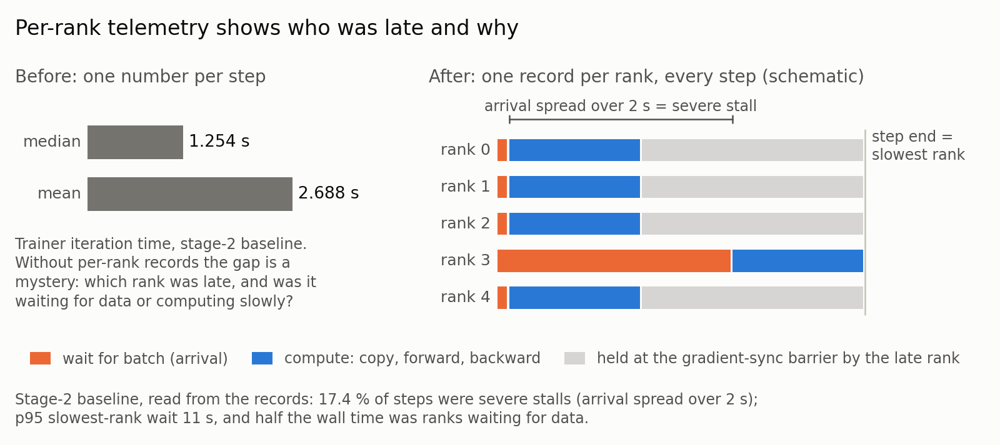
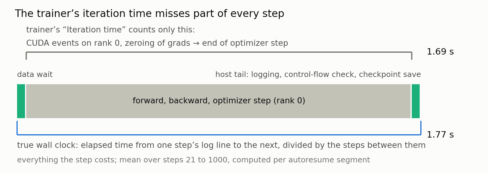
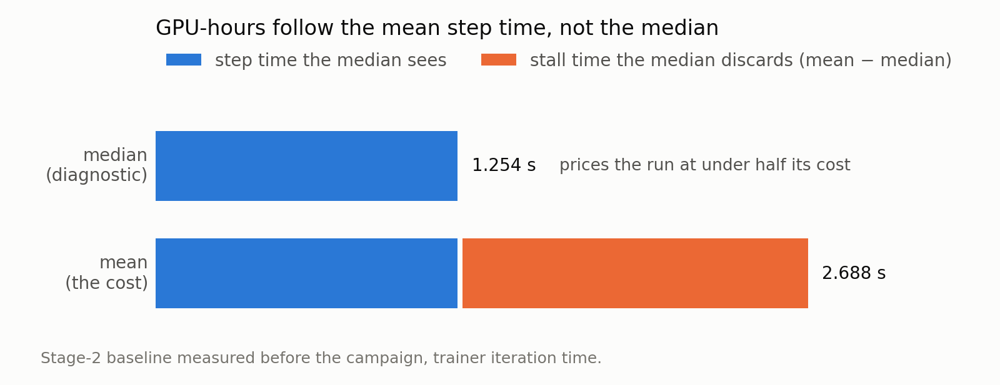
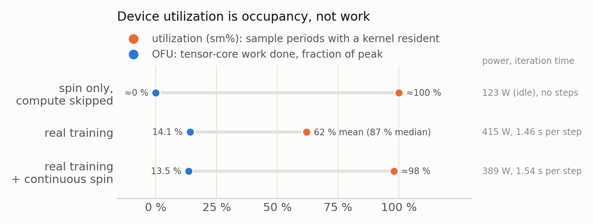
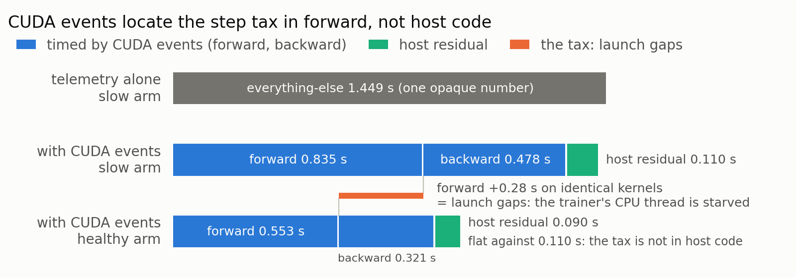

## Summary
训练效率的核心指标是训练 step（一次训练迭代，即一次 optimizer 更新）的 GPU-hour 消耗；trainer 日志里的 `iteration time` 只是量其中一段的计时器（见第 2 项）。排查效率问题时，很容易被表面指标误导，如设备GPU利用率很高但实际吞吐低。本章介绍训练效率的测量与评估方法，分三部分：效率指标（怎么量准）、监控方法（怎么持续发现异常）、问题定位（按症状找到瓶颈点），各条后面的编号对应正文的小节。

**效率指标**:
- `severe stall`: 一个 rank 拖住全体的训练 step 占比(各 rank 到达时间差 > 2 s),衡量数据等待造成的浪费 (见第 1 项)
- `wall clock`: 从日志时间戳算完整的 s/step (见第 2 项)
- `GPU-hour`: 用 `wall clock` 均值算,不用中位数 (见第 3 项)
- `MFU / HFU / OFU`: 看实际算力利用,不看设备利用率 (见第 4 项)

**监控方法**:训练中的持续记录与回归监控,以及单独测量某一段的方法（第 6~10 项持续补充中）
- 逐 rank 遥测与 `severe stall`: 记录每个 rank 的等待与计算,定位拖慢整体的 rank (见第 1 项)
- CUDA event 分解: 把训练 step 拆成 `arrival` / `forward` / `backward` / `host residual` (见第 5 项)
- 回归带: 定期跑固定配方,给 loss、训练 step 时间、MFU、显存设范围,超出就报警 (见第 6 项)
- 取证: 出现非有限梯度时保存现场,不在健康训练 step 上加 collective (见第 7 项)
- benchmark harness: 跳过 optimizer,单独量 loader 与启动时间 (见第 8 项)
- 分项 loss 与截断日志: 各项 loss 分开记,截断样本留身份 (见第 9 项)
- profiler: 离线 trace,细到模块和算子 (见第 10 项)

**问题定位**:遇到具体症状时,看对应的指标和瓶颈定位:

| 症状 | 表现 | 看哪些指标 |
|---|---|---|
| 训练 step 慢于硬件预期，原因不明 | 设备利用率（`sm%`）高、loss 正常，但每个训练 step 的 `wall clock` 比硬件预期长 | 真实 `wall clock / step`;`arrival`、`forward`、`backward`、`host residual` (详见第 2、5 项;细到模块和算子见第 10 项) |
| 单个 rank 拖慢所有 rank | 各训练 step 的 `wall clock` 均值远高于中位数；周期性出现多秒的训练 step，此时有的 rank 在等 batch，有的 rank 已在等梯度同步 | `arrival`(即 data wait)、`severe stall`、`stall gap`、`clean step` (详见第 1 项;单独量 loader 见第 8 项) |
| 每个训练 step 都有固定的额外开销 | 各训练 step 的 `wall clock` 均值与中位数接近（没有长尾），但都高于对照配置：每个训练 step 都稳定地多花一段时间 | `forward`、`backward`、`host residual` (详见第 5 项;细到算子见第 10 项) |
| GPU 利用率接近 100%，但吞吐偏低 | 设备利用率（`sm%`）接近 100%，但 `OFU` 很低、功耗接近空闲 | `MFU`、`HFU`、`OFU`、`HFU / OFU`、功耗;不看设备利用率(`sm%`) (详见第 4 项) |
| 汇报的数字与实际 GPU-hour 账单不一致 | 日志里的 `iteration time` 低于真实 `wall clock`；或用中位数估算的成本，低于实际 `GPU-hour` 账单 | 真实 `wall clock / step`、`GPU-hour`(用均值),对照 `iteration time` (详见第 2、3 项) |

---

## 1. 逐 rank 遥测与 `severe stall`: 记录每个 rank 的等待与计算,定位拖慢整体的 rank

**思路**:



同步数据并行训练中，训练 step 的时长由最慢的 rank 决定。仅凭 job 级别的单步耗时，无法区分以下情形：是单个 rank 变慢还是所有 rank 变慢；是数据供给不足（个别 rank 的 batch 到达较晚，或整个 loader 落后），还是计算本身变慢（个别节点异常或受到干扰，或整体变慢）。不同情形的处理方式不同，因此需要先定位。
每个训练 step，每个 rank 产生一条记录，由 rank 0 汇总。由这些记录可导出四个量：
- `instrument wall`：每个训练 step 中，各 rank 的 `arrival`（等待 batch 的时间）与 `arrival-else`（收到 batch 之后到 step 结束的时间，含 H2D 拷贝、forward、backward、梯度同步）之和，取各 rank 中的最大值，即最慢 rank（如图中的 rank 3）的训练 step 总耗时；
- `severe stall`：各 rank 到达时间`arrival`之差（最大值减最小值,如图rank3和ranke0）大于 2 s 的训练 step，表示存在 rank 在等待数据；
- `clean step`：最大 arrival 不超过 0.1 s 的训练 step，表示 loader 没有造成可见的等待；
- `stall gap`：全部训练 step 的 `instrument wall` 均值，减去 `clean step` 的 `instrument wall` 均值，即 stall 带来的额外耗时。

stall 指标取“差值”而不是绝对值：若一个 rank 等待 11 s 而其他 rank 仅等待 0.1 s，无论计算耗时如何，都说明 loader 出现了问题。分析时应以决定训练 step 时长的那个 rank 为准，而不是对各 rank 取平均；并同时报告均值、中位数、severe 比例以及 arrival 的 p95 / p99，这四项分别对应四种不同的失败形态。

**实现**:

每条记录包含：该 rank 等待 batch 的时间（`arrival`），从收到 batch 到训练 step 结束的时间（含 H2D 拷贝、forward、backward、梯度同步，记为 `arrival-else`，代码中的字段为 `fwd_bwd_time_s`），forward 与 backward 的 GPU event 计时（见第 5 项），样本数与 token 数，以及设备显存。rank 0 汇总各 rank 的记录后，以一行 JSON-lines 追加写入文件。

分析方式如下：

```python
# 每步每 rank 一条记录，rank 0 汇总写 JSON-lines；字段：
#   arrival_time_s, fwd_bwd_time_s, forward_time_s, backward_time_s,
#   sample_count, real_tokens, device_used_bytes
rows = [json.loads(l) for l in open("rank_timings.jsonl")]
sel  = rows[20:1000]                                   # 丢弃 compile warm-up 阶段
wall = [max(x["arrival_time_s"] + x["fwd_bwd_time_s"] for x in r["ranks"]) for r in sel]
sev  = sum(1 for r in sel
           if max(x["arrival_time_s"] for x in r["ranks"])
            - min(x["arrival_time_s"] for x in r["ranks"]) > 2)
```

**实验数据**:(内部数据供参考)

实验设置：2B 模型，16 节点 / 128 GPU，1,000 步 benchmark；口径为逐 rank 遥测的 `instrument wall`（step 21~1,000），severe 采用“到达时间差 > 2 s”的定义。下表是同一模型、同样数据下的三种 stage 2 配置（配置由模型规模、训练阶段、并行 topology、per-GPU batch 和 loader 变体决定；各 loader 变体见 01 章），仅依据逐 rank 遥测的指标，即可判断各自属于哪一类问题：

| 配置 | `instrument wall` 均值 (s) | `instrument wall` 中位数 (s) | `severe stall` 比例 | `arrival` p95 (s) | 判断 |
|---|---:|---:|---:|---:|---|
| loader 变体 A：整样本预处理，打包后丢弃原始图像帧 | 2.138 | 1.104 | 18.0% | 6.78 | 均值远高于中位数，`severe stall` 比例高：长尾延迟问题，应优化 loader 的供给稳定性 |
| loader 变体 B：逐帧流式预处理 | 1.576 | 1.556 | 0.0% | 0.29 | 均值接近中位数，无 stall：loader 供给稳定，应进一步排查 compute 等开销（见第 5 项 CUDA event 分解） |
| 对照基线：loader 优化全部关闭，eager（不使用 `torch.compile`） | 2.472 | 1.524 | 15.3% | 7.03 | 与变体 A 相同：长尾延迟问题（eager 下 stall 特征不变） |

说明：
- 本章的表格采用 `severe stall` 的定义（各 rank 到达时间差 > 2 s）。其他资料中也可能采用 `absolute stall` 的定义（最慢 rank 的等待 > 5 s），使用时应注明所采用的是哪一种。
- `severe stall` 差值定义的局限性：当所有 rank 同时等待数据时，各 rank 的到达时间差很小，`severe stall` 无法识别这种情形。例如，一次实验的均值为 7.32 s/step，却只有 2.3% 的训练 step 被判为 `severe stall`，因为所有 rank 同时在等待。因此应将均值、中位数和到达时间差一并阅读，也可采用“最慢 rank 等待 > 5 s”的 `absolute stall` 定义，补充覆盖这种情形。
- `instrument wall` 均值不代表实际训练 `wall clock` 的均值：`instrument wall` 不含训练 step 间的尾部（inter-step tail，即上一个 step 的 optimizer 结束到下一个 step 开始之间的时间，包括等待下一个 batch 与 host 侧工作），因此比基于 trainer 日志时间戳的真实 `wall clock` 约小几十毫秒（见第 2 项）。此外，前约 20 个训练 step 含有 compile 与首个 epoch 的影响，统计时应丢弃。

**适用场景**:所有训练任务，建议默认开启。成本是每个训练 step 写入一行 JSON；此后“时间花在哪里”这类问题，都可以通过对已有数据的一次查询来回答。

---

## 2. `wall clock`: 从日志时间戳算完整的 s/step

**思路**:

`wall clock` 是整个训练 step 的完整耗时，包括 data wait、计算和 host tail；trainer 日志的 `iteration time` 只覆盖其中的计算部分，因此偏小。成本核算和前后对比应使用 `wall clock`，`iteration time` 用于诊断。



Trainer 在每个训练 step 打印一个 `iteration time`。它测量的是 rank 0 的计算：从梯度清零到 optimizer step 结束的 CUDA event 区间，**不包含** step 之前等待 batch 的时间，也**不包含** step 之后的 host 工作（日志、控制流检查、checkpoint 保存）。因此它会低估一个训练 step 的真实耗时：在2B 模型 stage 2 的实验中（训练 step 最短）低估约 13%。第 1 项中的 `instrument wall` 同样不含 step 之后的 host 工作，也存在这一低估。`wall clock` 是训练 step 时间取两条 rank-0 日志之间的时间差，除以其间的训练 step 数。这样得到的是一个训练 step 花费的全部时间，包括图中的 data wait、计算（forward / backward、optimizer）和 host tail。

**实现**:

长时间的训练任务通常由多次调度器分配首尾相接而成：一次分配达到时间上限（或被抢占、节点故障）后，调度器重新排队，任务从最近的 checkpoint 恢复后继续训练（autoresume）。每一次分配称为一个 segment（也称一次 job attempt）。相邻 segment 之间有排队、重启和 checkpoint 加载的间隔，这段时间不属于训练 step 时间，因此需要按 segment 计算 `wall clock`：
1. 读取每个 autoresume segment 的 rank-0 日志；
2. 匹配其中带时间戳和训练 step 号的日志行（例如 `[rank0] <时间戳> ... Step: N/总步数, ... Iteration time`）；
3. 每个 segment 内，仅保留所选窗口内的行，并丢弃该 segment 的前 20 行（每次启动或重启后的 compile warm-up 与 cache 填充）；
4. 每个 segment 取最后一行与第一行的时间戳差（秒）和训练 step 号差（步），再将各 segment 的秒数之和除以步数之和，得到训练 step 时间。

实现时需遵守以下规则：
- **不跨 segment 相减时间戳**：segment 之间的间隔（排队、重启、checkpoint 加载和 warm-up）不是训练 step 时间。
- **重跑的训练 step 在两个 segment 中都要计数**：任务恢复后会从最近的 checkpoint 重新训练。例如在第 9,400 步被重新排队、从第 9,000 步的 checkpoint 恢复，则第 9,001~9,400 步会在两个 segment 中各跑一次。重跑所消耗的时间是真实发生的训练开销，应一并计入；两次均计入，才能使计算出的训练 step 时间反映实际的训练速率。
- **注明统计窗口**：整个 run，或最后 1,000 步。窗口内发生的一切（checkpoint、评测暂停等）都会被计入，窗口过短会使结果波动较大，建议至少使用几百个训练 step。
- **基线与新结果使用同一口径**：引用某个改动相对基线的收益时，基线应按真实 `wall clock` 重新计算；日志已丢失、无法重算的历史数据，应注明其原口径。若基线取自 trainer 日志的 `iteration time`，则得到的加速比只是真实收益的下界。
- **回归 gate 与成本核算**：回归 gate（见第 6 项）可出于稳定性对中位数或 `iteration time` 设带，成本核算仍应使用 `wall clock` 的均值。

下面的脚本改编自内部使用的实现，按上述四步计算。日志格式因 trainer 而异，使用时需要按实际的日志调整其中的正则表达式。

```python
import datetime, glob, re

# 日志示例：[rank0] 2026-09-09 22:35:12,345 ... Step: 21/1000, ... Iteration time: 1.53s
pat = re.compile(r"\[rank0\].*?(\d{4}-\d\d-\d\d \d\d:\d\d:\d\d,\d+).*Step: (\d+)/\d+")

job_dir = "..."        # 作业目录，其下每个 autoresume segment 各有一份 rank-0 日志
lo, hi = 1, 10**9      # 统计窗口：整个 run，或例如最后 1,000 步

tot_s = tot_n = 0
for f in sorted(glob.glob(f"{job_dir}/**/rank0.log", recursive=True)):   # 每个 segment 一份
    rows = [(datetime.datetime.strptime(m[1], "%Y-%m-%d %H:%M:%S,%f"), int(m[2]))
            for m in map(pat.search, open(f, errors="replace")) if m and lo <= int(m[2]) <= hi]
    rows = rows[20:]                                        # 丢弃该 segment 的 warm-up
    if len(rows) > 1:
        tot_s += (rows[-1][0] - rows[0][0]).total_seconds() # 只在 segment 内部相减
        tot_n += rows[-1][1] - rows[0][1]
step_time = tot_s / tot_n                                   # 秒数之和 / 步数之和（s/step）
```

**实验数据**:(内部数据供参考)

同一个 run 上的两种口径（2B 模型 stage 1，16 节点，100k 步参照跑）：`wall clock` 比 `iteration time` 多出 data wait 和 host tail 的部分，高约 0.08 s（约 5%）。

| 口径 | 均值 |
|---|---:|
| trainer `iteration time` | 1.69 s |
| 真实 `wall clock` / 训练 step | 1.77 s |

**适用场景**：

`wall clock` 适用于所有作为最终汇报口径的训练 step 时间，以及改动前后、不同配置之间的比较。这类场景要求时间统计完整，不能遗漏 data wait 和 host tail。trainer 的 `iteration time` 和逐 rank 遥测可同步用于诊断。

---

## 3. `GPU-hour`: 用 `wall clock` 均值算,不用中位数

**思路**:



`GPU-hour` 是训练成本的核算指标：它按每个训练 step 累计，等于训练 step 的 `wall clock` 均值、步数和 GPU 数的乘积，可以把一小段窗口里测得的 `wall clock` 均值计算成目标训练长度（例如 10 万步）的成本。

关键在于使用 `wall clock` 的**均值**。stall 会抬高 `wall clock` 的均值，而中位数会丢掉这部分：一个 stall 严重的 run 可能给出看似良好的中位数，实际成本却可能是中位数所暗示成本的两倍。因此成本核算应使用 `wall clock` 的均值，而不是中位数。

**实现**:

计算公式（训练 step 时间取 `wall clock` 的均值；公式中的 100,000 是用于估算成本的训练 step 数）：

```python
gpu_hours_per_100k = mean_wall_s_per_step * 100_000 * num_gpus / 3600
e2e_days_per_100k  = mean_wall_s_per_step * 100_000 / 86_400
```
其中训练 step 时间的均值应注明统计窗口和步数：短窗口的均值对单次 stall 很敏感，建议用至少几百个训练 step 来计算均值。

**实验数据**:(内部数据供参考)

实验设置：2B 模型按公式计算每 10 万步的 `GPU-hour` 和端到端时间：

| 配置 | `wall clock` 均值 (s/step) | GPU 数 | `GPU-hour`（10 万步，计算） | 端到端（10 万步，计算） |
|---|---:|---:|---:|---:|
| A：优化前 | 2.402 | 128 | 8,541 | 2.78 天 |
| B：叠加优化后 | 0.737 | 128 | 2,619 | 0.85 天 |

**适用场景**：所有 GPU-hour、成本或端到端时间的估算，以及不同 topology 之间的成本比较。

---

## 4. `MFU / HFU / OFU`: 看实际算力利用,不看设备利用率

**思路**:



设备监控给出的“利用率”（`nvidia-smi` 的 `sm%`）是**占用率**：采样周期内有任意 kernel 驻留在设备上的比例。它不反映驻留的工作用了多少硬件峰值，一个空转的 kernel（不做有用计算、只占用 GPU 的 kernel，如 `torch.cuda._sleep`）在空闲功耗下也会读到约 100%。以下三个指标把“实际工作效率”与“硬件峰值能力”联系起来：
- `MFU`（model FLOP utilization）：模型每个训练 step 需要的有用浮点运算量，除以耗时和硬件峰值。运算量按 6N 约定估算（forward + backward 每个 token 约 6×N 次运算，N 为参数量）。硬件峰值有带稀疏和稠密（dense）两种口径，只有以稠密峰值计算的 `MFU` 可与公开文献中的 MFU 比较。
- `HFU`（hardware FLOP utilization）：同一估算按 8N 约定，多计了 activation checkpointing 重算的 forward，即硬件实际执行的运算量。
- `OFU`（operational FLOP utilization）：**测量值，不是估算值**。每个节点由一个旁路进程采样设备监控的 tensor-core 活动和时钟，OFU = 活动 × （当前时钟 / 最大时钟）。

**实现**:

- `MFU` / `HFU`：统计每个训练 step 处理的 token 数，按 6N（`MFU`）或 8N（`HFU`）估算运算量（N 为参数量），再除以训练 step 时间与硬件峰值 FLOPS。模型由多个组件构成时（如视觉编码器、语言模型、expert），按各组件自己的参数量和 token 数分别估算后相加。部分训练框架已提供相应接口，可直接调用；
- `OFU`：用 `nvidia-smi dmon --gpm-metrics 5` 起一个旁路采样进程，读取 tensor-core 活动和时钟，按 `OFU` = 活动 × （当前时钟 / 最大时钟）计算；

示意代码：

```python
def flop_utilization(params, tokens_per_step, step_time_s, peak_flops_per_gpu, num_gpus, factor):
    # factor = 6：MFU；factor = 8：HFU（多计 activation checkpointing 重算的 forward）
    return factor * params * tokens_per_step / (step_time_s * peak_flops_per_gpu * num_gpus)
```

**实验数据**:(内部数据供参考)

对比三种 run（2B 模型，1 节点，`iteration time` 口径）：仅空转（跳过训练计算，只运行空转 kernel）、真实训练（不空转）、真实训练加持续空转（训练的同时一直运行空转 kernel）。可以发现，利用率（`sm%`）不等于实际算力利用率（`OFU`）：空转能把利用率读数提高到接近 100%，但 `OFU` 没有提高，`iteration time` 反而变慢（1 节点退步约 5%，4 节点退步约 14%）。

| run | 利用率 (`sm%`) | `OFU` | `iteration time` | 功耗 |
|---|---:|---:|---:|---:|
| 仅空转（跳过计算） | 约 100% | 约 0% | 不适用 | 约 123 W（空闲） |
| 真实训练 | 62% / 87%（中位） | 14.1% | 1.46 s | 415 W |
| 真实训练 + 持续空转 | 约 98% | 13.5% | 1.54 s | 389 W |

**适用场景**：跨模型规模或 topology 比较配置，以及判断某个 GPU-bound 的配置是否仍有提升空间。应使用 `OFU`、`MFU` 和功耗来判断，不应使用设备利用率；空转只应用于 warm-up 期间。

**延伸：避免 job 被空闲 GPU 回收器误终止（Alpamayo 训练中的 keep-alive 做法）**

部分集群会终止 GPU 长时间没有活动的 job（空闲 GPU 回收器），而 job 启动后的几分钟（初始化、加载 checkpoint、编译等）利用率本来就接近零，可能在第一个训练 step 之前就被终止。Alpamayo 训练中采用 keep-alive 来避免这种情况：在 warm-up 期间让 GPU 保持“有活动”。集群没有这类回收策略时不需要。
- **做法**：warm-up 期间在专用 stream 上以约 50 ms 的 `torch.cuda._sleep` 脉冲空转；第一个训练 step 时切换到休眠状态；最后一步停止。
- **必须休眠**：常驻的空转 kernel 不能被 all-reduce 抢占，持续空转会使训练 step 变慢，代价随节点数增长。keep-alive 只用于满足回收器的判断，不应作为效率的证据。

验证（2B 模型1 节点 × 8 GPU）：开启 keep-alive 后，warm-up 阶段的利用率读数由 16%（中位数 0%）升至 88%（中位数 100%），功耗不变，稳态 `iteration time` 不变。这个对比只验证 keep-alive 的机制和代价，不涉及性能收益。

| 配置 | warm-up `sm%` 均值 / 中位数 | warm-up 功耗 | 稳态 `iteration time` 均值 (s) |
|---|---:|---:|---:|
| keep-alive 开（默认） | 88% / 100% | 132 W | 1.600 |
| keep-alive 关（对照） | 16% / 0% | 135 W | 1.593 |

---

## 5. CUDA event 分解: 把训练 step 拆成 `arrival` / `forward` / `backward` / `host residual`

**思路**:



第 1 项的遥测把训练 step 拆成“等待（`arrival`）”和 `arrival-else` 两块。当 `arrival-else` 本身变长时，需要进一步判断时间花在哪里：forward 计算、backward 加梯度 all-reduce，还是两者之间的 host 工作。

做法：启用逐 rank 遥测后，trainer 用 CUDA event（`torch.cuda.Event(enable_timing=True)`，由 GPU 在自己的 stream 上打的时间戳）包住 forward 和 backward。两个 event 之间的时间**包含 GPU 等待 CPU 提交下一个 kernel 的间隙**，即 event 区间 = kernel 时间 + launch 间隙。

于是在决定训练 step 时长的那个 rank 上，一个训练 step 分为四段：`arrival`（loader 遥测）、`forward` 和 `backward`（event）、`host residual`（ `arrival-else` − forward − backward，即数据搬运、optimizer 的 host 侧开销、阶段之间的 Python 代码）。读法：`host residual` 变长，说明阶段之间的 host 代码变慢；`forward` 或 `backward` 变长而 kernel 和数据都没有变，则只可能是 launch 间隙，即向 GPU 提交 kernel 的 CPU 线程受到了干扰。

**实现**:

数据来自第 1 项的逐 rank 记录，一次查询即可（示意）：

```python
# 每步取 fwd_bwd_time_s 最大的 rank，读它的 forward / backward，计算 residual
for r in rows[20:1000]:
    x = max(r["ranks"], key=lambda e: e["fwd_bwd_time_s"])
    residual = x["fwd_bwd_time_s"] - x["forward_time_s"] - x["backward_time_s"]
# 报告各段的中位数
```

event 在 forward 前后、`loss.backward()` 前后各放一对。实现时需遵守以下规则：
- **event 区间同时包含 kernel 时间和 launch 间隙**：因此 “forward 变慢” 不等于 “模型变慢”。应先固定 kernel（输入逐位相同、编译相同），此时任何差值都是 launch 间隙。
- **backward 会吸收同步等待**：一个 rank 在阻塞的梯度 collective 中等待被卡住的同伴，会把这段等待记为 backward 时间（例如某个使用 4 个 worker 的配置，`backward` 中位数为 0.920 s，而正常配置为 0.398 s）。应只对 `arrival` 曲线正常的配置做分解。
- **event 的开销可忽略，但只有逐 rank 遥测打开时才存在**：需要在 benchmark 时就开启；没有开启时，可改用 profiler trace（第 10 项）这一更重的离线方案。

**实验数据**:(内部数据供参考)

实验背景：在优化 data loader 的过程中，发现除 `arrival`（等待 batch）之外，`arrival-else` 变长了（采用逐帧流式预处理的配置里，每个训练 step 的 `arrival-else` 明显增加），需要用 CUDA event 进一步判断是哪一段变长。

实验目的：通过拆解判断瓶颈在哪一段，从而确定优化方向。

实验设置：2B 模型 stage 2，16 节点，1,000 步 benchmark；各段取决定训练 step 时长的那个 rank 上的中位数（逐 rank 遥测，step 21~1,000），单位为秒。两种 loader 变体与第 1 节相同：

| 配置 | `arrival-else` | `forward` | `backward` | `host residual` |
|---|---:|---:|---:|---:|
| loader 变体 A：整样本预处理，打包后丢弃原始图像帧 | 1.017 | 0.553 | 0.321 | 0.090 |
| loader 变体 B：逐帧流式预处理 | 1.449 | 0.835 | 0.478 | 0.110 |

说明：
- 表中各段取的是中位数，所以几段之和不一定等于 `arrival-else`（例如第一行 1.017 − 0.553 − 0.321 ≠ 0.090）。
- 变体 B 的 `arrival-else` 比变体 A 多出约 0.43 s，而 `host residual` 只变化约 0.02 s，说明增加的开销几乎都落在 GPU 计时的区间内。其中 `forward` 增加约 **0.28 s**（0.553 → 0.835），而两者的 batch 逐位相同、编译的 kernel 也相同，推断差别是 forward launch 间隙问题：trainer 的 CPU 线程得不到足够的 CPU 资源。
- 数据加载侧的 CPU 分区修复印证了这一判断：在 10 个 worker 的配置下，为 trainer 划分专用物理核后，`forward` 中位数由 0.766 s 降至 0.589 s。

**适用场景**：第 1 项的逐 rank 遥测显示 `arrival` 正常（没有明显的等待数据问题），而训练 step 仍然偏慢、`arrival-else` 偏长时，用 CUDA event 把 `arrival-else` 拆成 `forward`、`backward` 和 `host residual`，定位瓶颈在哪一段，再决定优化方向。在对训练 step 时间回归提出假设之前，应先做分解，再提出假设。

---

## 6. 回归带: 定期跑固定配方,给 loss、训练 step 时间、MFU、显存设范围,超出就报警

待补充。

---

## 7. 取证: 出现非有限梯度时保存现场,不在健康训练 step 上加 collective

待补充。

---

## 8. benchmark harness: 跳过 optimizer,单独量 loader 与启动时间

待补充。

---

## 9. 分项 loss 与截断日志: 各项 loss 分开记,截断样本留身份

待补充。

---

## 10. profiler: 离线 trace,细到模块和算子

待补充。
