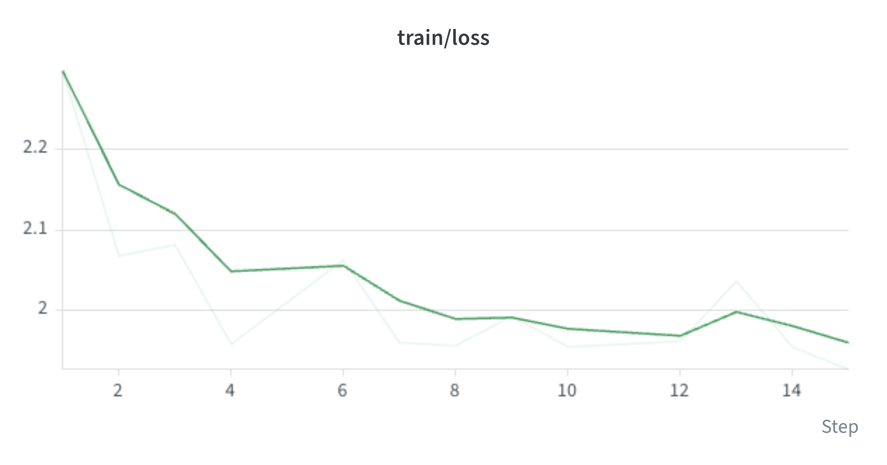

# Alpamayo 2 Edge SFT

Supervised fine-tuning for the Cosmos3-Edge 2B backbone with a SigLIP2 vision
encoder in [Alpamayo 2 Edge](https://huggingface.co/nvidia/Alpamayo2-Edge). Training uses
its [inference package](https://github.com/NVlabs/alpamayo2-edge.git) and the
PhysicalAI-Autonomous-Vehicles (PAI) dataset.

The released model's native task is **navigation + reasoning + trajectory**.
Use `sft_joint_nav_cot` to preserve that task. `sft_joint`, `sft_joint_nav`, and
`sft_joint_cot` support fine-tuning with missing annotation types, but change the
prompt format. Results in those formats also measure adaptation to the new task;
they are not native-prompt release baselines.

## Joint training

Driving examples supervise discrete future-trajectory tokens in the VLM and
acceleration/curvature flow matching (FM) in the trajectory expert. The expert
uses detached VLM conditioning, so its gradients do not update the VLM. CoT
variants also supervise reasoning text. Navigation is an input.

The supplied configs train one driving dataset. Custom datasets can also supply
VQA examples without trajectories: the joint model trains their text objective
and uses a zero-weight expert pass to keep distributed training synchronized.
Mixed batches accept a per-row `traj_data` list with `None` for missing labels;
a future-trajectory start token requires trajectory labels for that row. The
recipe does not supply a VQA dataset or replay mixture. Evaluate capabilities you
need to retain when adapting the model. Configuration uses [Hydra configs](./configs/).

## Installation

Use Linux, Python 3.12, BF16-capable NVIDIA GPUs, and a CUDA development toolkit
with `nvcc`, headers, and libraries. CUDA 12.8 matches the locked PyTorch runtime. DeepSpeed still needs
the toolkit. Set it in each training shell, including inside GPU allocations.

```bash
curl -LsSf https://astral.sh/uv/install.sh | sh
export PATH="$HOME/.local/bin:$PATH"
export YOUR_HOME="/path/to/your/workspace"
export UV_CACHE_DIR="$YOUR_HOME/.cache/uv"
export OMP_NUM_THREADS=1 MKL_NUM_THREADS=1 OPENBLAS_NUM_THREADS=1
export TOKENIZERS_PARALLELISM=false
export CUDA_HOME="/path/to/cuda-toolkit"
export PATH="$CUDA_HOME/bin:$PATH"
"$CUDA_HOME/bin/nvcc" --version

export REPO_DIR="$YOUR_HOME/alpamayo-recipes"
git clone https://github.com/NVlabs/alpamayo-recipes.git "$REPO_DIR"
cd "$REPO_DIR/recipes/alpamayo2edge_sft"
uv venv "$YOUR_HOME/envs/a2e_sft" --python 3.12
source "$YOUR_HOME/envs/a2e_sft/bin/activate"
uv sync --active --locked
python -c "import torch, deepspeed; print('CUDA:', torch.cuda.is_available(), torch.version.cuda)"
```

For an existing checkout containing this recipe, set `REPO_DIR` to its root and
skip cloning.

Keep the complete checkout: `uv sync`
installs shared PAI helpers from `src/` through its default `shared` dependency
group. Installing the recipe wheel alone does not install these checkout-local
helpers; install `src/` separately if assembling an environment without uv.

## Prepare the checkpoint

Authenticate with a Hugging Face token that can read the model repository.
Download an explicit revision and retain it with your experiment configuration:

```bash
hf auth login
hf auth whoami
export MODEL_DIR="$YOUR_HOME/checkpoints/alpamayo2-edge"
hf download nvidia/Alpamayo2-Edge \
  --revision "$MODEL_REVISION" --local-dir "$MODEL_DIR"
```

`MODEL_DIR` must contain the config, tokenizer, processor, and every weight shard.
To use an existing export, set `MODEL_DIR` to that directory and skip the download.

## Prepare PAI data

Obtain access to the [PAI dataset](https://huggingface.co/datasets/nvidia/PhysicalAI-Autonomous-Vehicles).
The recipe uses six cameras and 22 frames, with 64 future waypoints at 10 Hz.
The download below uses chunks 729–743 for training and official-validation chunks
1134–1144 for evaluation. Chunk intervals are half-open.

```bash
export PAI_DIR="$YOUR_HOME/data/pai"
export PAI_REVISION=33f9bf447ed3bcb7d545ce13f4226f824214fafb
cd "$REPO_DIR"
for CHUNKS in 729-744 1134-1145; do
  python scripts/download_pai.py \
    --revision "$PAI_REVISION" --profile edge --chunk-ids "$CHUNKS" \
    --camera camera_cross_left_120fov camera_front_wide_120fov \
      camera_cross_right_120fov camera_rear_left_70fov \
      camera_rear_right_70fov camera_front_tele_30fov \
    --labels egomotion --output-dir "$PAI_DIR"
done
```

At the pinned revision, these camera and egomotion archives total about **181 GiB**
(195 GB), plus metadata and local caches. The downloader records the resolved
dataset revision in `download_manifest.json`.
Keep the downloaded `clip_index.parquet` in `PAI_DIR`, as PAI evaluation requires
this file, or the file selected by `data.val_dataset.clip_index_metadata`, even
with a custom dataset interface. It hashes the metadata to identify the
validation selection and fails if the file is missing.
Use `--profile edge` with both `download_pai.py` and `curate_pai_samples.py`:
their shared default remains the legacy event window for older recipes.
Training draws deterministic random timestamps on a 0.1-second grid between
2.0 and 13.6 seconds, changing with the epoch. Validation uses a fixed timestamp.

To establish model-unseen
data, report the provenance and overlap checks for your evaluation set, and keep
entire drives separate between training and validation. The default `split`
filter preserves official membership and yields 1,443 training and 1,055
validation clips. The bundled
[driving-session audit](./assets/pai_driving_disjoint_chunks.json) covers the
unseen data chunks by Alpamayo2-edge model.

### Navigation and reasoning annotations

Annotation JSON contains events for the same videos and egomotion:

```json
[{"clip_id": "<PAI clip UUID>", "t0_relative": 5000000,
  "nav_text": "Turn left in 25m", "cot": "Yield to oncoming traffic before turning left."}]
```

`t0_relative` is microseconds from clip start. Navigation, reasoning, and the
trajectory must describe the same event. Use the `cot` field for reasoning,
including labels called CoC. Match the release's navigation style: for example,
`Turn left in 25m`, `Keep right in 80m`, `Exit roundabout`, `Exit rotary`, or
`Take the ramp straight`. Distances are integer metres within 250 m, and a distant
maneuver is not an immediate turn target.

For intentionally reviewed custom instruction syntax, pass
`--no-validate-navigation-format` to `prepare_pai_annotations.py` and set
`data.train_dataset.validate_navigation_format=false` and
`data.val_dataset.validate_navigation_format=false` when loading those annotations.

The bundled [demo asset](./assets/nav_demo_samples.json) contains 19 events from
18 clips. Navigation and
relative timestamps originate in the
[Alpamayo1.5 demo](https://github.com/NVlabs/alpamayo1.5/blob/main/notebooks/nav_demo_samples.json).
Reasoning was generated by Alpamayo2 Edge, reviewed, and edited to remove flagged
unsupported wording. These are synthetic demonstration annotations, not human
ground truth. The additional demo camera/egomotion archives total about **147 GiB**
(158 GB), before caches.

```bash
cd "$REPO_DIR"
python scripts/download_pai.py \
  --revision "$PAI_REVISION" --profile edge \
  --chunk-ids "214 224 276 420 727 728 968 982 1519 1657 1984 2277 2368 2372 2447 2599 2634 2868" \
  --camera camera_cross_left_120fov camera_front_wide_120fov \
    camera_cross_right_120fov camera_rear_left_70fov \
    camera_rear_right_70fov camera_front_tele_30fov \
  --labels egomotion --output-dir "$PAI_DIR"

export ANNOTATION_VERSION=nav-cot-demo
export PAI_CLIP_INDEX=clip_index.parquet
export SPLIT_DIR="$YOUR_HOME/outputs/annotations-$ANNOTATION_VERSION"
python scripts/prepare_pai_annotations.py \
  --annotations-json recipes/alpamayo2edge_sft/assets/nav_demo_samples.json \
  --clip-index "$PAI_DIR/$PAI_CLIP_INDEX" \
  --output-dir "$SPLIT_DIR" --val-fraction 0.2 --seed 5
export TRAIN_ANNOTATIONS="$SPLIT_DIR/nav_cot_train.json"
export VAL_ANNOTATIONS="$SPLIT_DIR/nav_cot_val.json"
```

This tiny split is a **pipeline smoke test only**. For the bundled asset, seed 5
was checked against driving-session metadata: training and validation share no
clips or drives. The four validation events contain three left turns and one
right turn; this is too small to establish generalization.

**Demo training includes five official-validation clips and one official-test
clip.** Use a separate, drive-disjoint and
maneuver-representative validation set for quality comparisons.

### Public CoC labels with your navigation

PAI's public CoC labels describe selected events and differ from route-conditioned reasoning and nominal
labels used by the release. Review their suitability for your task before use.
At the pinned revision, downloading **all** eligible CoC chunks with six cameras
requires about **7.7 TiB** (8.47 TB) of archives across 935 chunks, before caches.
The example below bounds the selection to 16 eligible reasoning clips. Downloads
still contain whole camera chunks, so reserve substantially more space than for
16 individual clips. Remove `--num-reasoning-clips` only for the full download.

```bash
cd "$REPO_DIR"
python scripts/download_pai.py \
  --revision "$PAI_REVISION" --profile edge --only-reasoning-chunks \
  --num-reasoning-clips 16 --random-seed 11 \
  --reasoning ood_reasoning.parquet --labels egomotion \
  --camera camera_cross_left_120fov camera_front_wide_120fov \
    camera_cross_right_120fov camera_rear_left_70fov \
    camera_rear_right_70fov camera_front_tele_30fov \
  --output-dir "$PAI_DIR"

export SPLIT_DIR="$YOUR_HOME/outputs/public-coc-nav-v1"
export PAI_CLIP_INDEX="$PAI_DIR/clip_index_reasoning_mini.parquet"
python scripts/prepare_pai_annotations.py \
  --pai-dir "$PAI_DIR" --navigation-json /path/to/reviewed-navigation.json \
  --clip-index "$PAI_CLIP_INDEX" \
  --output-dir "$SPLIT_DIR"
export TRAIN_ANNOTATIONS="$SPLIT_DIR/nav_cot_train.json"
export VAL_ANNOTATIONS="$SPLIT_DIR/nav_cot_val.json"
export ANNOTATION_VERSION=public-coc-nav-v1
```

The navigation JSON uses the event schema above; `cot` is optional when joining
public CoC. Joins require exact clip IDs and timestamps. Omit `--navigation-json`
for CoC-only training, set `TRAIN_ANNOTATIONS="$SPLIT_DIR/cot_train.json"` and
`VAL_ANNOTATIONS="$SPLIT_DIR/cot_val.json"`, and choose `PAI_TASK=cot` below.
The 16-clip example is a **pipeline smoke test only**, including its `cot_val.json`:
at the pinned revision and seed 11 it has only **three validation events from
three clips**, and another sampling seed can leave no validation events. For CoT minADE comparisons, use the full
official CoC validation split: **226 clips / 266 events** in the 2.0–13.6-second
Edge window. Use the full CoC download described above and the complete index
below. Navigation joins can reduce this set, so report the retained event count
for Nav+CoC.
The shared setup below applies `PAI_CLIP_INDEX` to training and evaluation.
For the full download, omit `--clip-index` and set
`PAI_CLIP_INDEX=clip_index.parquet` to use the complete PAI index.
The helper preserves official train/validation assignments, reports dropped
labels and unmatched navigation, and writes label statistics. For additional
filtering, `data.*_dataset.clip_index_metadata` accepts a PAI-format clip-index
parquet; keep annotation and clip-index selections consistent.

## Optional ONCE and Tartan Drive data

ONCE and Tartan use the same joint objective and three-epoch defaults with a
real front camera and trajectory labels. The experiments outlined here are
trajectory-only adaptations.

### Obtain and arrange the files

Download data from its provider and retain the source version and checksums.
The recipe's Apache-2.0 license covers its code; it does not grant rights to
third-party datasets or override the terms governing their derived outputs.

**ONCE terms:** ONCE is provided under
[CC BY-NC-SA 4.0](https://creativecommons.org/licenses/by-nc-sa/4.0/) and the
[ONCE Dataset Terms](https://once-for-auto-driving.github.io/terms_of_use.html).
Use of the dataset and derivative works (tables, charts, etc.) is restricted to
non-commercial purposes. The provider prohibits redistribution of the dataset
or modified versions.

Download annotation and front-camera archives (`*_infos.tar`, `*_cam01.tar`)
from the [official downloads](https://once-for-auto-driving.github.io/download.html).
The adapter accepts uncompressed archives in this layout:

```text
ONCE/
  train_anno/train_infos.tar
  train_camera/train_cam01.tar
  val_anno/val_infos.tar
  val_camera/val_cam01.tar
```

**ONCE sampling variant:** The [released cameras and poses](https://once-for-auto-driving.github.io/documentation.html)
are nominally 2 Hz. The adapter selects the latest frame at or before each
requested offset and retains repeated captures with their actual timestamps.
With regular 2 Hz frames, the default requests `[-2, -1, -0.5, -0.1, 0]` produce
actual offsets `[-2, -1, -0.5, -0.5, 0]`: five input slots, four unique images.
Actual intervals and the number of unique images can vary.

Trajectory labels use piecewise linear position interpolation and normalized
linear quaternion interpolation (NLERP). The default 64 future samples at
0.1-second intervals are interpolated from the sparse released poses.

**Tartan Drive 2.0 terms:**
The provider's [MIT license](https://github.com/castacks/tartan_drive_2.0/blob/main/LICENSE)
covers software and associated documentation.
Confirm the dataset's usage, redistribution, and derived-results publication
terms with the provider before use.

Follow the [provider's downloader instructions](https://github.com/castacks/tartan_drive_2.0)
for the left-color camera and `super_odom` modalities. For the geographic audit
below, also obtain `gps_odom` and the corresponding provider GPS metadata.
Keep this training-data layout:

```text
TartanDrive/
  <recording>/
    image_left_color.tar          # contains 000000.png, ..., and timestamps.txt
    super_odom/odometry.npy
    super_odom/timestamps.txt
```

An extracted `image_left_color/` directory with the same sibling files is also
supported. Camera `timestamps.txt` contains strictly increasing timestamps in
seconds: row N belongs to image N, with exactly one row per image and contiguous
zero-based filenames. Preserve this association from the original provider
export.

### Define and audit the split

Both adapters require `driving.split_manifest`. Assign entire recordings to one
split, grouping nearby recordings from the same session or route together.
Audit the full recording intervals and routes, including every input frame and
future-label window. Both adapters recompute this audit from the loaded manifest
at every dataset initialization.

The example below supplies only temporal fields; replace the IDs and times with
your complete recording intervals. Use `"dataset": "tartan"` for Tartan.
Times are integer Unix microseconds.

**ONCE:** The [released poses](https://once-for-auto-driving.github.io/documentation.html)
are relative to each sequence's first frame, so they cannot establish distance
between recordings. The annotation/camera archives above do not provide the
shared geographic coordinates required by the full audit. Use the temporal-only
command below unless you obtain independently verified routes in a common frame.
Different recording IDs, dates, or image hashes do not establish geographic
separation.

```json
{
  "schema_version": 1,
  "dataset": "once",
  "train": ["000001"],
  "val": ["000002"],
  "recordings": {
    "000001": {
      "source_partition": "train",
      "start_time_us": 1600000000000000,
      "end_time_us": 1600000600000000,
      "time_reference": "unix"
    },
    "000002": {
      "source_partition": "val",
      "start_time_us": 1600200000000000,
      "end_time_us": 1600200600000000,
      "time_reference": "unix"
    }
  }
}
```

**Temporal-only demonstration:** Set the dataset and paths, then check every
cross-split recording interval with a 24-hour buffer:

```bash
cd "$REPO_DIR/recipes/alpamayo2edge_sft"
export DRIVING_DATASET=once          # change to tartan for Tartan Drive
export DRIVING_DATA_ROOT=/path/to/data
export DRIVING_SPLIT=/path/to/reviewed-split.json
export DRIVING_MIN_TIME_GAP_SECONDS=86400
export DRIVING_MIN_LOCATION_GAP_M=250
export DRIVING_TEMPORAL_ONLY=true
python -m alpamayo2edge_sft.prepare_driving_splits \
  --dataset "$DRIVING_DATASET" --manifest "$DRIVING_SPLIT" \
  --min-time-gap-seconds "$DRIVING_MIN_TIME_GAP_SECONDS" \
  --min-location-gap-m "$DRIVING_MIN_LOCATION_GAP_M" --temporal-only \
  --output "$YOUR_HOME/outputs/$DRIVING_DATASET-split-temporal-audit.json"
```

A passing result is `passed_temporal_only`, with `full_validation_passed: false`.
Report geographic separation as **unverified**. Tartan recordings can revisit
the same site on different days, so time separation alone is insufficient there
too.

**Full time-and-location audit:** First supply verified geographic metadata for
every recording:

- `positions_xy_m`: the complete route as an ordered list of `[x, y]` positions,
  covering all image, history, and future-label intervals.
- `spatial_frame`: one common projected coordinate frame across recordings,
  with `spatial_units: "metres"`.
- `spatial_frame_verified: true` and `spatial_frame_evidence`: describe the source
  modality, source version/checksums, coordinate transform, and verification of
  the common frame and timestamp coverage. Setting the flag alone is not evidence.

For Tartan's Gascola recordings, use `gps_odom/odometry.npy` and
`gps_odom/timestamps.txt` for location evidence. Check that the GPS XYZ values
match the provider's corresponding `bags/<recording>/gps.npy` metadata. The
[provider's map viewer](https://github.com/castacks/tartan_drive_2.0/blob/main/scripts/tartandrive_gui.py)
places those points on [its Gascola map](https://github.com/castacks/tartan_drive_2.0/blob/main/assets/gascola.tif)
as `easting = -gps[:, 1]`, `northing = gps[:, 0]`. The map identifies
**EPSG:26917 (NAD83 / UTM zone 17N), in metres**. This is the verified Gascola
export convention; do not assume it for another export or substitute reset
`super_odom` coordinates. Verify GPS coverage of the actual camera and trajectory
windows, and record gaps or uncovered endpoints. A route-distance bound applies
to the supplied GPS polylines, not unobserved positions or camera viewing regions.

With that evidence in the manifest, reuse the paths and buffers above and select
full validation for both the precheck and the training/evaluation commands:

```bash
export DRIVING_TEMPORAL_ONLY=false
python -m alpamayo2edge_sft.prepare_driving_splits \
  --dataset "$DRIVING_DATASET" --manifest "$DRIVING_SPLIT" \
  --min-time-gap-seconds "$DRIVING_MIN_TIME_GAP_SECONDS" \
  --min-location-gap-m "$DRIVING_MIN_LOCATION_GAP_M" \
  --output "$YOUR_HOME/outputs/$DRIVING_DATASET-split-full-audit.json"
```

Missing spatial evidence fails full validation, including at runtime. The audit
checks all cross-split pairs using a conservative bound for the supplied route
polylines. The **24-hour / 250-metre** buffers are starting criteria.

Continue with the shared [training](#train-jointly) and [evaluation](#evaluation)
commands below.

## Hyperparameters and logging

| Setting | Default |
|---------|---------|
| Language / vision and projector / expert learning rate | `3.5e-6` / `3.5e-7` / `1.4e-5` |
| Budget | 3 epochs; positive `trainer.max_steps` overrides epochs |
| Batch per GPU / gradient accumulation | 1 / 8; global batch 64 on eight GPUs |
| Warmup / schedule | 4% of updates, then cosine decay to 1% of peak LR |
| Optimizer | AdamW, betas `(0.9, 0.95)`, weight decay `0.1` on all trainable parameters |
| Token weights | Future trajectory `1.0`, text `0.2`; denominator counts all supervised tokens |
| Precision | FP32 master weights and optimizer state; BF16 computation |
| Joint gradient norm (`trainer.gradient_norm_algorithm`) | `auto` (default) selects a model-ordered FP32 FSDP-style norm on supported ZeRO-3/FSDP2 setups; otherwise it uses the backend norm and warns once per trainer/optimizer instance on each process. `fsdp_fp32` rejects unsupported setups instead of falling back; `engine` keeps backend arithmetic. Clip threshold: `trainer.max_grad_norm=1.0`. |
| Q/K backward layout | Disabled|
| Padding / retained checkpoints | Pad to longest sequence in batch / 3 |
| Data loader workers | 4 per GPU; tune for your allocated CPUs, RAM, and storage |

For the default PAI trajectory-only subset of **1,443 training clips**, eight GPUs
with batch size 1 per GPU and gradient accumulation 8 give **23 optimizer updates
per epoch**, **69 updates over three epochs**, and **3 warmup updates**. These
counts change with the dataset size, GPU count, batch size, or accumulation.

The matched norm path requires Torch **2.8.0** and GPU data parallelism. For
DeepSpeed **0.19.1**, it requires ZeRO-3, BF16 computation, FP32 gradient
accumulation and optimizer master weights, a unit loss scale, no optimizer
offload or swapping, and no model, tensor, or sequence parallelism. The optimizer
must expose valid, non-scalar parameter partitions covered by the model. FSDP2
requires dense FP32 gradients on one shared, one-dimensional `Shard(0)` mesh,
with contiguous local shards.

Start with the default three epochs and evaluate the initial checkpoint and each
epoch on the same validation cohort. As terrain, camera setup, or
vehicle dynamics differ more from the model's training distribution, expect to
need more diverse, representative target data and careful validation. Verify camera timing, coordinate frames, and trajectory labels before tuning
hyperparameters.

Checkpoint training state can occupy roughly
35–40 GB per save, in addition to the model, data, and environment.

To visualize and track the training performance use WB using the following commands:

```bash
wandb login
export WANDB_ENTITY="<your-team-or-username>"
export WANDB_PROJECT=alpamayo2edge-sft
export WANDB_MODE=online
```

## Train jointly

Run inside an eight-GPU allocation with the environment and CUDA toolkit active.
Use Bash and run **one** of the following setup blocks, then use the shared
training and evaluation commands in the same shell.

**PAI:** choose `PAI_TASK=nav_cot` for the native task, `trajectory` for
trajectory-only, `nav` for navigation + trajectory, or `cot` for reasoning +
trajectory. For annotated tasks, set `TRAIN_ANNOTATIONS`, `VAL_ANNOTATIONS`, and
`ANNOTATION_VERSION` during annotation preparation above.

```bash
export PAI_TASK=nav_cot             # trajectory, nav, cot, or nav_cot
CONFIG_SUFFIX="_$PAI_TASK"
if [ "$PAI_TASK" = trajectory ]; then CONFIG_SUFFIX=""; fi
TRAIN_CONFIG="sft_joint$CONFIG_SUFFIX"
EVAL_CONFIG="sft_eval_trajectory$CONFIG_SUFFIX"
RUN_LABEL="pai-$PAI_TASK"
TRAIN_DATA_ARGS=(
  "data.train_dataset.local_dir=$PAI_DIR"
  "data.val_dataset.local_dir=$PAI_DIR"
)
EVAL_DATA_ARGS=("${TRAIN_DATA_ARGS[@]}")
if [ "$PAI_TASK" != trajectory ]; then
  TRAIN_DATA_ARGS+=(
    "data.train_dataset.annotations_path=$TRAIN_ANNOTATIONS"
    "data.val_dataset.annotations_path=$VAL_ANNOTATIONS"
    "data.train_dataset.clip_index_metadata=${PAI_CLIP_INDEX:-clip_index.parquet}"
    "data.val_dataset.clip_index_metadata=${PAI_CLIP_INDEX:-clip_index.parquet}"
  )
  EVAL_DATA_ARGS+=(
    "data.val_dataset.annotations_path=$VAL_ANNOTATIONS"
    "data.val_dataset.clip_index_metadata=${PAI_CLIP_INDEX:-clip_index.parquet}"
  )
  RUN_LABEL="$RUN_LABEL-$ANNOTATION_VERSION"
fi
```

**ONCE or Tartan:** use the `DRIVING_DATASET`, `DRIVING_DATA_ROOT`, and
`DRIVING_SPLIT` set during preparation above. The selected audit mode and buffers
apply to both training and evaluation. Changing `DRIVING_DATASET` from `once` to
`tartan` selects the other adapter; update the root and manifest too.

```bash
TRAIN_CONFIG="sft_joint_$DRIVING_DATASET"
EVAL_CONFIG="sft_eval_trajectory_$DRIVING_DATASET"
RUN_LABEL="$DRIVING_DATASET-trajectory"
TRAIN_DATA_ARGS=(
  "driving.data_root=$DRIVING_DATA_ROOT"
  "driving.split_manifest=$DRIVING_SPLIT"
  "driving.split_audit.temporal_only=${DRIVING_TEMPORAL_ONLY:-true}"
  "driving.split_audit.min_time_gap_seconds=${DRIVING_MIN_TIME_GAP_SECONDS:-86400}"
  "driving.split_audit.min_location_gap_m=${DRIVING_MIN_LOCATION_GAP_M:-250}"
)
EVAL_DATA_ARGS=("${TRAIN_DATA_ARGS[@]}")
```

Only for a **Tartan legacy demonstration without camera timestamps**, append
these overrides to both commands. Replace the evidence text with your export's
version/source and the known unverified mapping assumption:

```bash
LEGACY_TIMING_ARGS=(
  "driving.allow_unverified_image_timestamps=true"
  "driving.legacy_image_timestamp_evidence='My export/version; image N assumed to match TartanVO row N; unverified'"
)
TRAIN_DATA_ARGS+=("${LEGACY_TIMING_ARGS[@]}")
EVAL_DATA_ARGS+=("${LEGACY_TIMING_ARGS[@]}")
```

**Train any selected dataset/task:**

```bash
cd "$REPO_DIR/recipes/alpamayo2edge_sft"
export RUN_NAME="edge-$RUN_LABEL-$(date +%Y%m%d-%H%M%S)"
export TRAIN_OUTPUT="$YOUR_HOME/outputs/$RUN_NAME"
torchrun --standalone --nproc_per_node 8 -m alpamayo2edge_sft.train_hf \
  --config-path pkg://alpamayo2edge_sft/configs --config-name "$TRAIN_CONFIG" \
  model.pretrained_model_name_or_path="$MODEL_DIR" \
  "${TRAIN_DATA_ARGS[@]}" \
  paths.output_dir="$TRAIN_OUTPUT" \
  trainer.report_to=wandb trainer.run_name="$RUN_NAME"
```

For ONCE/Tartan, adapter overrides belong under `driving.train` or `driving.val`,
for example `driving.train.sample_stride_seconds=4`. Defaults use all complete
windows, five requested front-camera slots at `[-2, -1, -0.5, -0.1, 0]` seconds,
and anchors at least two seconds apart. ONCE repeats captures as described above.
Keep `time_step=0.1` and `num_future_steps=64` for the released checkpoint;
Keep validation selection fixed across checkpoint comparisons: add custom
validation-selection overrides to both `TRAIN_DATA_ARGS` and `EVAL_DATA_ARGS`.

For CPU-rich allocations, compare 12 and 32 workers per GPU against the default.
Append these overrides to the training command, replacing `12` with `32` for the
larger setting:

```bash
  trainer.dataloader_num_workers=12 \
  +trainer.dataloader_persistent_workers=true \
  +trainer.dataloader_prefetch_factor=2
```

Use a unique output directory for each new run. To resume, retain the original
`TRAIN_OUTPUT`, `RUN_NAME`, dataset/task selection, and overrides, and append
`trainer.resume_from_checkpoint=/path/to/checkpoint-N` to the training command.

Validation runs before training and at each epoch end; a complete checkpoint is
saved after each epoch, retaining three. For step-based saves/evaluation, set
`trainer.save_strategy=steps`, `trainer.save_steps=N`,
`trainer.eval_strategy=steps`, and `+trainer.eval_steps=N`.

Monitor total loss, `train/vlm_ce`, `train/expert_diffusion`, and their validation
counterparts. Decreasing training loss alone does not establish better driving.
`others_ce` is zero when there are no supervised non-trajectory tokens.

Illustrative training loss for **PAI trajectory-only adaptation**
(`PAI_TASK=trajectory`):



The illustration above is using the default recipe on eight GPUs, with trainer.dataloader_num_workers=32. Training completed three epochs (69 optimizer updates).

## Evaluation

Use the matching `EVAL_CONFIG` and `EVAL_DATA_ARGS` from the setup block above to
compare **step zero and all three epoch checkpoints** on identical validation
events, with repeated sampling seeds. Keep the initial checkpoint eligible for
selection. For CoT variants, reference CoT is excluded from generation; the model
generates reasoning itself. ONCE/Tartan use trajectory-only generation.

```bash
cd "$REPO_DIR/recipes/alpamayo2edge_sft"
for CKPT in "$MODEL_DIR" "$TRAIN_OUTPUT"/checkpoint-*; do
  for SEED in 42 43; do
    CUDA_VISIBLE_DEVICES=0 python -m alpamayo2edge_sft.evaluate_hf \
      --config-path pkg://alpamayo2edge_sft/configs \
      --config-name "$EVAL_CONFIG" \
      evaluate.eval_ckpt="$CKPT" evaluate.max_eval_steps=-1 seed="$SEED" \
      "${EVAL_DATA_ARGS[@]}" \
      paths.output_dir="$YOUR_HOME/outputs/$RUN_NAME-evaluations" \
      trainer.report_to=wandb trainer.run_name="$RUN_NAME-eval-seed$SEED"
  done
done
```

The evaluator creates a unique checkpoint-labelled subdirectory for every run,
with `eval_results.json`, `evaluation_protocol.json`, `trajectory_samples.jsonl`,
`trajectory_summary.json`, and resolved config. Report **minADE@6 in metres**:
mean XY displacement over 64 waypoints, minimum across six candidates, then mean
across events.

Compare step zero with **all candidate checkpoints in one invocation**, using
the resulting run directories (the ones containing `evaluation_protocol.json`).
Public PAI metadata has no session IDs, so this command reports descriptive paired
means and their difference without a confidence interval or significance claim:

```bash
python -m alpamayo2edge_sft.compare_evaluations \
  --baseline /path/to/base-seed42 /path/to/base-seed43 \
  --candidate epoch1 /path/to/epoch1-seed42 /path/to/epoch1-seed43 \
  --candidate epoch2 /path/to/epoch2-seed42 /path/to/epoch2-seed43 \
  --candidate epoch3 /path/to/epoch3-seed42 /path/to/epoch3-seed43 \
  --means-only \
  --output "$YOUR_HOME/outputs/edge-comparison.json"
```

Each `--candidate NAME DIR [DIR ...]` groups one checkpoint's repeated-seed
runs. All candidates are compared with the baseline on one shared event cohort.
For a single checkpoint pair, replace the candidate arguments with
`--sft /path/to/sft-seed42 /path/to/sft-seed43`. Separate pairwise invocations
can retain different events when failures are dropped; use the multi-checkpoint
command above when comparing candidates for selection.

For a paired session-bootstrap interval, replace `--means-only` with
`--session-map /path/to/clip_to_session.json --replications 10000 --seed 2026`.
The session-map file must contain verified driving-session groupings for every
evaluated clip, as a JSON object, for example:

```json
{"clip-uuid-1": "drive-A", "clip-uuid-2": "drive-A", "clip-uuid-3": "drive-B"}
```

For ONCE/Tartan, the event `clip_id` is the recording ID; map those IDs to
verified sessions. Report the split-manifest hash, recording counts, and coverage
with the metrics. Evaluation protocols include the runtime result under
`dataset_sampling_protocol.split_audit`: loaded manifest hash, effective policy,
audit status, temporal/full/spatial validation flags, recording counts, minimum
observed time gap, and limitations. A temporal-only pass does not establish
geographic separation.

Alternatively, `--session-metadata /path/to/index.parquet` accepts a clip index
with a `session_id`, `session`, or `drive_id` column. Public PAI clip-index and
collection metadata do not supply these session IDs, so passing the public
`clip_index.parquet` does not enable a session-bootstrap interval. Keep
`--means-only` when verified session groupings are unavailable.

For an exploratory interval without session metadata, replace `--means-only`
with `--assume-independent-clips --replications 10000 --seed 2026`. This paired
clip bootstrap averages repeated seeds per event and resamples whole clips,
keeping multiple timestamps from the same clip together. It requires at least
two clips and **assumes different clips are independent**. Clips from the same
drive can be correlated, making this interval too narrow. Use verified
session groupings for session-level uncertainty when available. These three
modes (`--means-only`, session metadata, and `--assume-independent-clips`) are
mutually exclusive.

The tool requires identical attempted events, recorded input/sampling settings,
and seed sets. New protocols record camera/frame settings, preprocessing,
precision, batch size, the download manifest's repository/revision, and hashes
of annotations and selection files. Identified copies can move between mounts;
edits in place change their identity. Tartan protocols also record each
recording's camera-clock source/hash, image-index hash, pose-clock hash, and
`contains_unverified_timing` under `dataset_sampling_protocol`. Results using
different timestamp sources are not comparable; regenerate evaluations under
the same timing protocol.

For completed runs with known
missing-trajectory-anchor failures, `--drop-failed-events` removes the **union**
of failures across the baseline, every supplied candidate, and every seed from
all comparisons. The report records a shared cohort identifier, exclusions,
per-run coverage, retained coverage, and each candidate's paired comparison. The estimates
are conditional on events where every run succeeded and can hide difficult-event
failures; always report coverage alongside them.

With verified session IDs, the tool averages paired seed differences per event
and resamples whole driving sessions to report a 95% confidence interval for
**SFT minus base minADE**.

Only PAI `nav_cot` preserves the native task format. Label comparisons using
other PAI tasks or ONCE/Tartan as task-format adaptation.

For supervised loss on any selected dataset/task, use `--config-name "$TRAIN_CONFIG"`
with the same `TRAIN_DATA_ARGS`, `evaluate.eval_ckpt`, and `trainer.deepspeed=null`.
This uses reference reasoning when available and preserves saved objective
weights, so it is a different check from generated-reasoning minADE.
`evaluate.max_eval_steps` limits batches in either evaluation mode.
